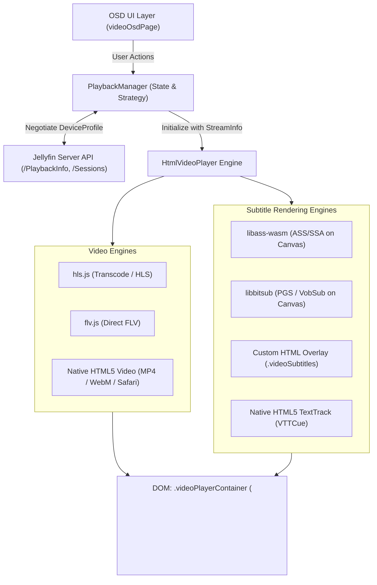

# Jellyfin Web Video Player & ASS Subtitle Implementation Guide
*A comprehensive technical specification and architectural blueprint for porting the Jellyfin Web Video Player to other applications.*

---

## 1. Executive Summary & Architecture Overview

The Jellyfin Web Video Player is a multi-engine media playback architecture built to deliver direct streaming, remuxing, dynamic transcoding, and client-side rendering of complex subtitle formats (notably ASS/SSA, PGS, VOBSub, and WebVTT).

### Core Architectural Layers

1. **Player Manager Layer (`PlaybackManager`)**:
   - Manages playback queue, playback state, and reporting to the Jellyfin API.
   - Negotiates device capabilities via `DeviceProfile` with `/Items/{itemId}/PlaybackInfo`.
   - Decides stream strategy: `DirectPlay`, `DirectStream`, or `Transcode`.
   - Manages track switching (audio and subtitles) and orchestrates stream re-negotiation when track changes cannot be handled client-side.

2. **Playback Engine Layer (`HtmlVideoPlayer`)**:
   - Implements the `MediaPlayer` plugin interface.
   - Manages the DOM lifecycle (`videoPlayerContainer`, `<video>` element, canvas overlays).
   - Routes streams to the appropriate player library:
     - **HLS.js**: For HLS streams (transcoded streams, live TV, remuxed HLS).
     - **flv.js**: For legacy direct-played FLV video containers.
     - **Native HTMLMediaElement**: For MP4, WebM, and Safari native HLS.

3. **Subtitle Subsystem Layer**:
   - **ASS/SSA Subtitles**: Rendered client-side onto a dedicated `<canvas>` overlay using WebAssembly and Web Workers (`@jellyfin/libass-wasm` / `JavascriptSubtitlesOctopus`).
   - **PGS / VobSub Subtitles**: Rendered onto canvas using WebAssembly (`libbitsub`).
   - **Text Subtitles (SRT / VTT)**: Rendered via browser native `VTTCue` / `TextTrack` or custom HTML DOM overlays (`.videoSubtitles`) to bypass browser styling bugs.
   - **Server Burn-in (`Encode`)**: When formats or codecs cannot be rendered client-side, the server burns subtitles directly into video frames via FFmpeg.

4. **UI Overlay Layer (`VideoOsdPage`)**:
   - Sits on top of the video container (`z-index` management).
   - Handles player controls, timeline slider, chapter markers, track selection menus, volume, and playback quality settings.



---

## 2. Server Negotiation & Stream Resolution

### 2.1 The `DeviceProfile`
Before playback begins, the client generates a `DeviceProfile` detailing its exact codec capabilities. This profile dictates whether the server will allow DirectPlay, perform DirectStream (remux container only), or full Transcoding.

#### Key Subtitle Profiles in `browserDeviceProfile.js`:
```typescript
interface SubtitleProfile {
    Format: 'vtt' | 'ass' | 'ssa' | 'pgssub' | 'vobsub';
    Method: 'External' | 'Embed' | 'Encode';
    Container?: string;
}
```

- When **Client-Side ASS Rendering** is enabled:
  ```json
  [
    { "Format": "vtt", "Method": "External" },
    { "Format": "ass", "Method": "External" },
    { "Format": "ssa", "Method": "External" }
  ]
  ```
- If the user settings dictate subtitle burn-in (`subtitleburnin === 'all'` or `'allcomplexformats'`), the `ass` and `ssa` external profiles are omitted. The server is then forced to transcode the video with subtitles burned in.
- If an ASS rendering failure occurs during playback, the client retries playback with `isRetry: true`, which removes `ass`/`ssa` external profiles, falling back to server burn-in.

### 2.2 `getPlaybackInfo` Request Contract
The client makes a `POST` request to `/Items/{itemId}/PlaybackInfo`:
```json
{
  "UserId": "<user-guid>",
  "StartTimeTicks": 0,
  "IsPlayback": true,
  "AutoOpenLiveStream": true,
  "AudioStreamIndex": 1,
  "SubtitleStreamIndex": 2,
  "MediaSourceId": "<media-source-id>",
  "MaxStreamingBitrate": 140000000,
  "DeviceProfile": {
    "Name": "Web Video Player",
    "DirectPlayProfiles": [
      { "Container": "mp4,m4v", "Type": "Video", "VideoCodec": "h264,hevc,vp9,av1", "AudioCodec": "aac,mp3,opus,flac" },
      { "Container": "webm", "Type": "Video", "VideoCodec": "vp8,vp9,av1", "AudioCodec": "vorbis,opus" }
    ],
    "CodecProfiles": [],
    "SubtitleProfiles": [
      { "Format": "vtt", "Method": "External" },
      { "Format": "ass", "Method": "External" },
      { "Format": "ssa", "Method": "External" },
      { "Format": "pgssub", "Method": "External" },
      { "Format": "vobsub", "Method": "External", "Container": "mks" }
    ],
    "ResponseProfiles": [
      { "Type": "Video", "Container": "m4v", "MimeType": "video/mp4" }
    ]
  }
}
```

### 2.3 Stream Selection Logic
The server response returns a list of `MediaSources`. Each `MediaSource` provides:
1. `SupportsDirectPlay`: If `true`, client streams the raw file without server processing.
2. `SupportsDirectStream`: If `true`, audio and video streams can be packaged into an HLS or MP4 container on the fly without re-encoding.
3. `SupportsTranscoding`: If `true`, server transcodes audio and/or video using FFmpeg.
4. `TranscodingUrl`: The relative URL for the HLS or progressive transcode stream (e.g. `/videos/{itemId}/master.m3u8?...`).

#### URL Construction Rules (`createStreamInfo`):
- **DirectPlay**:
  `{serverUrl}/Videos/{itemId}/stream.{container}?Static=true&mediaSourceId={sourceId}&deviceId={deviceId}&ApiKey={token}`
- **DirectStream**:
  `{serverUrl}/Videos/{itemId}/stream.{container}?Static=true&mediaSourceId={sourceId}&deviceId={deviceId}&ApiKey={token}`
- **Transcode (HLS)**:
  `{serverUrl}/{mediaSource.TranscodingUrl}` (pointing to `master.m3u8`).

---

## 3. Video Engine Implementation (`HtmlVideoPlayer`)

### 3.1 DOM Hierarchy and Layout

```html
<!-- Inserted as firstChild of document.body -->
<div class="videoPlayerContainer" dir="ltr">
    <!-- libass-wasm canvas container is injected here -->
    <div class="libassjs-canvas-parent">
        <canvas class="libassjs-canvas"></canvas>
    </div>

    <!-- HTML5 Video Element -->
    <video class="htmlvideoplayer" preload="metadata" autoplay playsinline webkit-playsinline></video>

    <!-- Custom HTML Subtitle Container for VTT/SRT (when not using native TextTrack) -->
    <div class="videoSubtitles">
        <div class="videoSubtitlesInner"></div>
        <div class="videoSecondarySubtitlesInner"></div>
    </div>
</div>
```

#### Essential CSS (`style.scss`):
```css
.videoPlayerContainer {
    position: fixed !important;
    top: 0;
    bottom: 0;
    left: 0;
    right: 0;
    display: flex;
    align-items: center;
    background: #000 !important;
    z-index: 0; /* Changed dynamically to 1000 when OSD is hidden */
}

/* Forces libass canvas parent to sit on top of the video element inside flexbox */
.videoPlayerContainer .libassjs-canvas-parent {
    order: -1;
    position: absolute;
    top: 0;
    left: 0;
    width: 100%;
    height: 100%;
    pointer-events: none; /* Crucial: clicks must pass through to video */
}

.htmlvideoplayer {
    margin: 0 !important;
    padding: 0 !important;
    width: 100%;
    height: 100%;
}
```

### 3.2 HLS Playback with `hls.js`

When `enableHlsJsPlayerForCodecs` returns true and `mediaSource.TranscodingSubProtocol === 'hls'`, Jellyfin initializes `Hls.js`:

```javascript
import Hls from 'hls.js/dist/hls.js';

// Global defaults set by Jellyfin
Hls.DefaultConfig.lowLatencyMode = false;
Hls.DefaultConfig.backBufferLength = Infinity;

async function setSrcWithHlsJs(videoElement, options, url) {
    // Dynamic buffer sizing: High bitrate 4K video can exhaust browser memory on Chromium/Firefox.
    // Clamp buffer length to 6 seconds for streams >= 25 Mbps, otherwise 30 seconds.
    let maxBufferLength = 30;
    if ((isChrome || isFirefox || isEdge) && maxStreamingBitrate >= 25000000) {
        maxBufferLength = 6;
    }

    const hls = new Hls({
        startPosition: (options.playerStartPositionTicks || 0) / 10000000,
        manifestLoadingTimeOut: 20000,
        maxBufferLength: maxBufferLength,
        maxMaxBufferLength: maxBufferLength,
        videoPreference: { preferHDR: true },
        xhrSetup(xhr) {
            xhr.withCredentials = includeCorsCredentials;
        }
    });

    hls.loadSource(url);
    hls.attachMedia(videoElement);

    // Error recovery binding
    hls.on(Hls.Events.ERROR, (event, data) => {
        if (data.fatal) {
            switch (data.type) {
                case Hls.ErrorTypes.NETWORK_ERROR:
                    console.warn('[hls.js] Fatal network error encountered, trying to recover');
                    hls.startLoad();
                    break;
                case Hls.ErrorTypes.MEDIA_ERROR:
                    console.warn('[hls.js] Fatal media error encountered, trying to recover');
                    hls.recoverMediaError();
                    break;
                default:
                    hls.destroy();
                    onErrorInternal(player, data);
                    break;
            }
        }
    });

    return hls;
}
```

### 3.3 Aspect Ratio Control
Aspect ratio is adjusted via standard CSS `object-fit`:
- `'auto'` -> `mediaElement.style.removeProperty('object-fit')`
- `'cover'` -> `mediaElement.style.objectFit = 'cover'`
- `'fill'` -> `mediaElement.style.objectFit = 'fill'`

Whenever the aspect ratio changes, if bitmap subtitles or ASS subtitles are rendering, call:
```javascript
subtitlesOctopusInstance.resize();
```

---

## 4. Deep-Dive: ASS/SSA Subtitle Implementation

Advanced SubStation Alpha (`.ass` / `.ssa`) subtitles feature vector graphics, per-syllable karaoke, complex font styling, blur, rotations, positioning, and animations. Browser native `VTTCue` and HTML cannot render these features faithfully.

Jellyfin renders ASS/SSA client-side using **`@jellyfin/libass-wasm`** (a specialized WebAssembly port of [libass](https://github.com/libass/libass) via `JavascriptSubtitlesOctopus`).

### 4.1 Asset Requirements & Directory Distribution
The WebAssembly engine consists of 4 assets that must be served as static files:
1. `subtitles-octopus-worker.js`: Web Worker controlling the libass WebAssembly instance.
2. `subtitles-octopus-worker.wasm`: Compiled libass, FreeType, HarfBuzz, and Fontconfig C-libraries in WebAssembly.
3. `subtitles-octopus-worker-legacy.js`: Fallback worker for engines lacking modern WASM support.
4. `default.woff2`: Default fallback font used when requested fonts are missing.

In Jellyfin Web, Webpack copies these files from `@jellyfin/libass-wasm/dist/js/*` into the `/libraries/` public path.

### 4.2 Subtitle & Font Discovery

An ASS file depends on specific fonts (e.g. Arial, Comic Sans, or custom Japanese typography). If fonts are not loaded into the WASM runtime, libass substitutes glyphs with the fallback font, breaking visual layouts.

Jellyfin gathers fonts from **two primary sources**:

#### 1. Embedded Container Attachments (`MediaAttachments`):
When a file (like an `.mkv`) contains embedded fonts, the Jellyfin server inspects them and exposes them in `mediaSource.MediaAttachments`:
```javascript
const supportedFonts = [
    'application/vnd.ms-opentype',
    'application/x-truetype-font',
    'font/otf',
    'font/ttf',
    'font/woff',
    'font/woff2'
];

const availableFonts = [];
const attachments = mediaSource.MediaAttachments || [];

attachments.forEach(attachment => {
    if (supportedFonts.includes(attachment.MimeType)) {
        // e.g. /Videos/{itemId}/{mediaSourceId}/Attachments/{index}
        availableFonts.push(apiClient.getUrl(attachment.DeliveryUrl));
    }
});
```

#### 2. Server Fallback Font Endpoint:
Jellyfin provides a server-wide font fallback endpoint:
`/FallbackFont/Fonts?ApiKey={token}`.
If `serverConfiguration.EnableFallbackFont` is true:
```javascript
const fontFiles = await apiClient.getJSON('/FallbackFont/Fonts');
fontFiles.forEach(font => {
    const fontUrl = apiClient.getUrl(`/FallbackFont/Fonts/${encodeURIComponent(font.Name)}`, {
        ApiKey: apiClient.accessToken()
    });
    availableFonts.push(fontUrl);
});
```

### 4.3 Subtitle URL Resolution
The external subtitle track URL is obtained via:
```javascript
function getTextTrackUrl(track, item, format) {
    if (track.Path && item.IsLocal) {
        return track.Path;
    }
    let url = apiClient.getUrl(track.DeliveryUrl);
    if (format) {
        // Jellyfin server supports .vtt, .js (JSON events), .ass
        url = url.replace('.vtt', format);
    }
    return url;
}
```
For ASS tracks, `track.DeliveryUrl` already points to the `.ass` endpoint:
`/Videos/{itemId}/{mediaSourceId}/Subtitles/{trackIndex}/Stream.ass`.

### 4.4 Initializing SubtitlesOctopus
Below is the exact production configuration used in Jellyfin:

```javascript
import SubtitlesOctopus from '@jellyfin/libass-wasm';

function renderSsaAss(videoElement, track, item, playOptions) {
    const mediaSource = playOptions.mediaSource;
    const videoStream = mediaSource.MediaStreams.find(s => s.Type === 'Video');

    // Transcoding offset calculation
    // When video is transcoded starting at an offset, video.currentTime starts at 0,
    // but subtitle timestamps are absolute to the media start!
    const timeOffset = (playOptions.transcodingOffsetTicks || 0) / 10000000;

    const options = {
        video: videoElement,
        subUrl: getTextTrackUrl(track, item),
        fonts: availableFonts, // URLs to embedded container fonts + server fallback fonts
        workerUrl: `${baseUrl}/libraries/subtitles-octopus-worker.js`,
        legacyWorkerUrl: `${baseUrl}/libraries/subtitles-octopus-worker-legacy.js`,
        
        // Error callback: If libass-wasm crashes, trigger fallback
        onError: (err) => {
            console.error('[SubtitlesOctopus] ASS render error:', err);
            currentAssRenderer = null;
            setTimeout(() => {
                onErrorInternal(player, 'ASS_RENDER_ERROR');
            }, 0);
        },

        // Time synchronization offset in seconds
        timeOffset: timeOffset,

        // Performance & Rendering Flags
        renderMode: 'wasm-blend', // High performance: libass blends directly into WASM framebuffer
        dropAllAnimations: false, // Keep complex animations, rotations, and movement
        libassMemoryLimit: 40,    // 40 MB memory limit for caching
        libassGlyphLimit: 40,     // 40 MB glyph cache limit
        targetFps: videoStream?.ReferenceFrameRate || 24, // Match subtitle render FPS to video FPS
        prescaleFactor: 0.8,      // Render at 80% resolution if constrained
        prescaleHeightLimit: 1080,
        maxRenderHeight: 2160,    // Maximum 4K render canvas
        resizeVariation: 0.2,     // 20% tolerance to avoid canvas recreation on micro-resizes
        renderAhead: 90           // Pre-render subtitle cues up to 90 seconds ahead
    };

    const renderer = new SubtitlesOctopus(options);
    return renderer;
}
```

### 4.5 Time Synchronization, Seeking, and Offset Adjustment

#### 1. Real-Time Time Sync Formula
The total subtitle time offset in seconds is:
$$\text{TotalOffset} = \frac{\text{transcodingOffsetTicks}}{10{,}000{,}000} + \text{userSubtitleOffsetSeconds}$$

```javascript
function getSubtitleTimeOffset(playOptions, userSubtitleOffset = 0) {
    return ((playOptions?.transcodingOffsetTicks || 0) / 10000000) + userSubtitleOffset;
}
```

#### 2. On User Manual Subtitle Sync Adjustments:
When the user adjusts subtitle sync in the OSD (e.g. $+250\text{ ms}$ or $-500\text{ ms}$):
```javascript
const setSubtitleOffset = debounce((offsetSeconds) => {
    if (currentAssRenderer) {
        currentAssRenderer.timeOffset = getSubtitleTimeOffset(currentPlayOptions, offsetSeconds);
    }
}, 100);
```

#### 3. Seeking & Starting Playback:
When the player starts or seeks, libass-wasm must flush its pre-rendered cache:
```javascript
function onSeekOrPlay(currentAssRenderer, playOptions, currentOffset) {
    if (currentAssRenderer) {
        currentAssRenderer.timeOffset = getSubtitleTimeOffset(playOptions, currentOffset);
        currentAssRenderer.resize();
        currentAssRenderer.resetRenderAheadCache(false);
    }
}
```

### 4.6 Switching Subtitle Tracks Dynamically
A critical capability of the Jellyfin web player is switching subtitle tracks **without reloading or interrupting the video stream**:

```javascript
function setSubtitleStreamIndex(newStreamIndex) {
    const mediaSource = currentPlayOptions.mediaSource;
    const mediaStreamTextTracks = mediaSource.MediaStreams.filter(s => s.Type === 'Subtitle');
    const newTrack = mediaStreamTextTracks.find(t => t.Index === newStreamIndex);

    // 1. Destroy existing ASS renderer instance
    if (currentAssRenderer) {
        currentAssRenderer.dispose(); // Terminates web worker, removes canvas, frees WASM memory
        currentAssRenderer = null;
    }

    if (!newTrack) {
        return; // Subtitles turned off
    }

    // 2. Determine delivery method
    const isDirectPlay = currentPlayOptions.playMethod === 'DirectPlay';
    const isExternal = newTrack.DeliveryMethod === 'External' || newTrack.IsExternal;

    if (isExternal || isDirectPlay) {
        // Can be handled client-side without restarting video stream!
        const format = (newTrack.Codec || '').toLowerCase();
        if (format === 'ass' || format === 'ssa') {
            currentAssRenderer = renderSsaAss(videoElement, newTrack, currentItem, currentPlayOptions);
        } else if (format === 'vtt' || format === 'subrip') {
            renderVttTrack(videoElement, newTrack, currentItem);
        }
    } else {
        // If track is not available externally, server MUST re-transcode with burned-in subs
        changeStream(player, getCurrentTicks(player), {
            SubtitleStreamIndex: newStreamIndex
        });
    }
}
```

### 4.7 ASS Error Recovery Ladder
If the user's browser or device has an incompatible WebAssembly setup, low memory, or a malformed ASS subtitle file causes `@jellyfin/libass-wasm` to crash:

```
[libass-wasm error] -> onError()
    ↓
Trigger MediaError.ASS_RENDER_ERROR
    ↓
PlaybackManager catches error
    ↓
Check if stream supports transcoding:
  - Yes: Re-request stream from server with isRetry = true
         (Removes 'ass' and 'ssa' from DeviceProfile.SubtitleProfiles)
         Server transcodes video with FFmpeg burning subtitles directly into video.
  - No: Display localized error notification to user.
```

---

## 5. Timeline Arithmetic & Server Reporting

### 5.1 Ticks Conversion Standard
Jellyfin uses **Ticks** as its universal time metric:
$$1\text{ second} = 10{,}000{,}000\text{ ticks}$$
$$1\text{ millisecond} = 10{,}000\text{ ticks}$$

- Seconds to Ticks: `Math.floor(seconds * 10000000)`
- Milliseconds to Ticks: `Math.floor(ms * 10000)`
- Ticks to Seconds: `ticks / 10000000`

### 5.2 Server Playback Reporting Protocol
The server tracks user watch progress, resume points, and active client sessions through 3 key endpoints on `/Sessions/Playing`:

1. **`reportPlaybackStart`** (Sent when `playing` event fires):
   ```json
   POST /Sessions/Playing
   {
     "ItemId": "<item-id>",
     "MediaSourceId": "<media-source-id>",
     "AudioStreamIndex": 1,
     "SubtitleStreamIndex": 2,
     "PlayMethod": "DirectPlay",
     "PositionTicks": 0,
     "IsPaused": false,
     "IsMuted": false,
     "VolumeLevel": 100,
     "PlaySessionId": "<play-session-id>"
   }
   ```

2. **`reportPlaybackProgress`** (Sent periodically every 10 seconds during `timeupdate`):
   ```json
   POST /Sessions/Playing/Progress
   {
     "ItemId": "<item-id>",
     "PositionTicks": 3450000000,
     "EventName": "timeupdate",
     "IsPaused": false,
     "PlaySessionId": "<play-session-id>"
   }
   ```

3. **`reportPlaybackStopped`** (Sent when user stops or media ends):
   ```json
   POST /Sessions/Playing/Stopped
   {
     "ItemId": "<item-id>",
     "PositionTicks": 5420000000,
     "PlaySessionId": "<play-session-id>"
   }
   ```

---

## 6. Implementation Checklist for AI Agents

When implementing or porting this video player into a new application, follow this sequential execution plan:

- [ ] **Step 1: Setup Static WebAssembly Assets**
  - Ensure `subtitles-octopus-worker.js`, `subtitles-octopus-worker.wasm`, and `default.woff2` are hosted and publicly accessible from a static path (e.g., `/workers/subtitles-octopus/`).
  - Configure CORS and MIME headers: `.wasm` files must be served with `Content-Type: application/wasm`.

- [ ] **Step 2: Construct the DOM Container**
  - Implement the parent wrapper `videoPlayerContainer` (`position: fixed; display: flex`).
  - Insert `<video class="htmlvideoplayer">` with `playsinline`.
  - Style `.libassjs-canvas-parent` with `order: -1; position: absolute; pointer-events: none;`.

- [ ] **Step 3: Implement DeviceProfile Generator**
  - Include external subtitle profiles for `vtt`, `ass`, `ssa`, and optionally `pgssub`.
  - Test browser support for H.264, HEVC, VP9, and AV1 using `HTMLMediaElement.canPlayType()`.

- [ ] **Step 4: Implement Stream Engine Coordinator**
  - For `DirectPlay`: set `video.src = streamUrl` and invoke `video.play()`.
  - For `Transcode` (HLS): initialize `hls.js`, attach to `video`, and handle media/network recovery.

- [ ] **Step 5: Integrate ASS Subtitle Rendering**
  - When an ASS track is selected, query `mediaSource.MediaAttachments` for embedded font URLs (`.ttf`, `.otf`, `.woff2`).
  - Pass the font list, video element, and track URL into `new SubtitlesOctopus(options)`.
  - Wire up `getSubtitleTimeOffset()` considering `transcodingOffsetTicks`.

- [ ] **Step 6: Handle Dynamic Track Switching**
  - On track change, call `currentAssRenderer.dispose()` before instantiating the new track.
  - If transitioning from server burn-in to external ASS, re-negotiate transcode without subtitles (`SubtitleStreamIndex: -1`).

- [ ] **Step 7: Wire Event Listeners & Destruction Lifecycle**
  - Bind `timeupdate`, `playing`, `pause`, `ended`, `volumechange`, `error`.
  - Implement full cleanup in `destroy()`: terminate Hls.js, call `octopus.dispose()`, remove video event listeners, and reset `video.src`.
