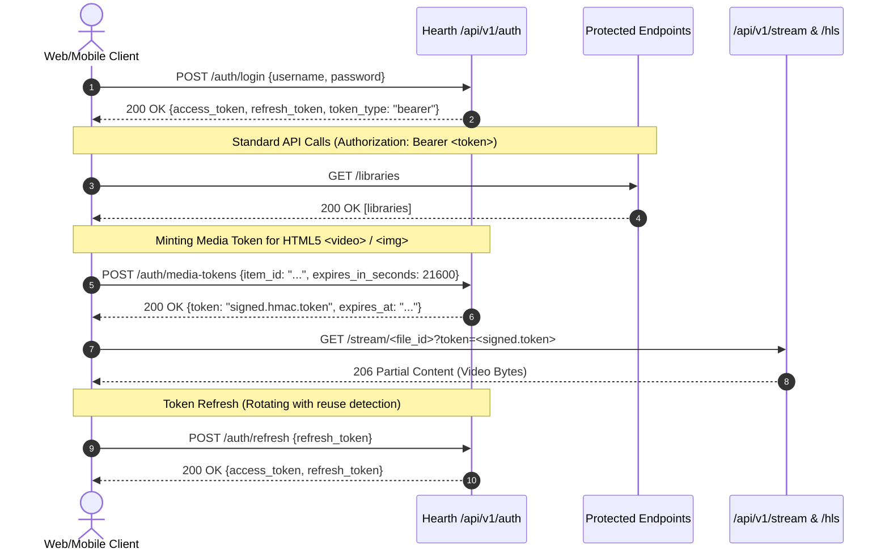
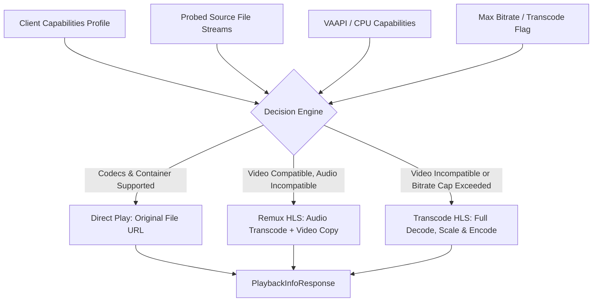

# Hearth Media Server: API Reference

This document provides a comprehensive guide to the Hearth REST API (`/api/v1`), including core conventions, authentication flows, the playback-info decision engine contract, streaming lifecycles, and event streaming.

---

## 1. General Conventions

- **Base URL**: All native API endpoints are prefixed with `/api/v1`.
- **Identifiers**: IDs are time-sortable UUIDv7 strings (36 characters), ensuring natural chronological ordering.
- **Timestamps**: All timestamps in requests and responses are ISO 8601 strings in UTC (`YYYY-MM-DDTHH:MM:SS.ffffffZ` or with `+00:00` offset).
- **Error Responses**: All HTTP errors return a standardized JSON envelope:
  ```json
  {
    "error": {
      "code": "item_not_found",
      "message": "Item not found",
      "details": {}
    }
  }
  ```
- **Correlation ID**: Every HTTP response echoes `X-Request-ID`. Clients may optionally provide an incoming `X-Request-ID` header matching `^[A-Za-z0-9._-]{1,64}$`.
- **Request Size Limit**: Request bodies are capped at 50 MiB by default. Exceeding this returns HTTP 413 (`payload_too_large`).
- **CORS**: Configurable via `HEARTH_CORS_ORIGINS`. Defaults to permissive origins for local network clients and exposes `ETag`, `Content-Length`, `Accept-Ranges`, `Content-Range`, and `X-Request-ID`.

---

## 2. Authentication and Authorization

Hearth provides two primary authentication mechanisms: **Bearer Access Tokens** for standard REST communication and **Scoped Media Tokens** for HTML5 media elements.



### 2.1 First-Run Setup
- **Endpoint**: `POST /api/v1/auth/setup`
- **Access**: Public, but **only allowed when zero users exist** in the system.
- **Request**:
  ```json
  {
    "username": "admin",
    "password": "correct horse battery staple"
  }
  ```
- **Response**: `201 Created` returning a full token pair and admin user object. Once completed, subsequent calls return `409 Conflict` (`setup_complete`).

### 2.2 Login
- **Endpoint**: `POST /api/v1/auth/login`
- **Request**:
  ```json
  {
    "username": "alice",
    "password": "supersecretpassword"
  }
  ```
- **Response**: `200 OK`
  ```json
  {
    "access_token": "eyJhbGciOi...",
    "refresh_token": "w8yv...",
    "token_type": "bearer",
    "expires_in": 900
  }
  ```
- **Security Features**:
  - Passwords hashed using Argon2id with random salts.
  - Dummy Argon2 verification is executed on unknown usernames to equalize timing and defeat user enumeration.
  - Rate limiting protects against brute-force attacks per IP and username.

### 2.3 Token Refresh and Reuse Detection
- **Endpoint**: `POST /api/v1/auth/refresh`
- **Request**:
  ```json
  {
    "refresh_token": "w8yv..."
  }
  ```
- **Rotation**: Refresh tokens are strictly single-use. Every successful refresh rotates the presented token and issues a new refresh token under the same `family_id`.
- **Reuse Detection**: If an already-rotated or revoked refresh token is presented again, Hearth assumes a replay attack, immediately revokes **all** active tokens in that family, and returns `401 Unauthorized` (`refresh_token_reuse`).

### 2.4 Scoped Media Tokens
Standard HTML `<video>`, `<audio>`, and `` tags cannot include custom `Authorization` HTTP headers.
- **Endpoint**: `POST /api/v1/auth/media-tokens`
- **Request**:
  ```json
  {
    "item_id": "018d3b50-...",
    "expires_in_seconds": 21600
  }
  ```
- **Usage**: Pass as a query parameter:
  - `<video src="/api/v1/stream/file-123?token=MEDIA_TOKEN">`
  - ``
  - `/api/v1/hls/session-789/master.m3u8?token=MEDIA_TOKEN`

### 2.5 Immediate Revocation and Role Enforcement
- Disabling a user in admin controls (`PATCH /api/v1/users/{id}`) revokes their access tokens immediately.
- Password resets increment the user's `token_version`, instantly invalidating existing JWTs.
- Hearth enforces roles: `admin` and `user`.
- Library isolation: Users without access to a specific library receive HTTP 404 (`item_not_found` / `library_not_found`), never leaking the existence of media.

---

## 3. Playback-Info Contract & Transcoding Architecture

The playback-info endpoint (`POST /api/v1/items/{item_id}/playback-info`) is the central contract for client playback negotiation. It evaluates client device capabilities against the probed source file, user streaming limits, and server hardware (VAAPI) capabilities.



### 3.1 Request Payload: Client Capability Profile
Clients provide their codec support, display bounds, and network restrictions, or choose from built-in device presets (`chrome`, `firefox`, `safari`, `android_tv`, `unknown`).

```json
{
  "client": {
    "preset": "chrome",
    "containers": ["mp4", "mkv", "webm"],
    "video_codecs": ["h264", "hevc", "av1", "vp9"],
    "audio_codecs": ["aac", "opus", "mp3", "flac"],
    "max_width": 1920,
    "max_height": 1080,
    "max_video_bitrate_kbps": 8000,
    "supports_hdr": false,
    "supports_hls_fmp4": true
  },
  "audio_index": 1,
  "subtitle_index": 0
}
```

### 3.2 Response Payload
The server returns the optimal playback method, stream URLs, active audio/subtitle track metadata, and human-readable decision reasons.

```json
{
  "method": "transcode_hls",
  "plan": {
    "video_action": "transcode",
    "audio_action": "transcode",
    "subtitle_action": "burn_in",
    "target_video_codec": "h264",
    "target_audio_codec": "aac",
    "target_width": 1920,
    "target_height": 1080,
    "reasons": [
      "Client max resolution 1920x1080 requires downscaling from 3840x2160",
      "Source HDR10 requires SDR tonemapping for client",
      "Bitmap PGS subtitles require video burn-in"
    ]
  },
  "stream_url": "/api/v1/hls/session-c70e28f2/master.m3u8",
  "session_id": "session-c70e28f2",
  "media_streams": {
    "video": [
      {"index": 0, "codec": "hevc", "width": 3840, "height": 2160, "hdr": true}
    ],
    "audio": [
      {"index": 1, "codec": "truehd", "channels": 8, "language": "eng"},
      {"index": 2, "codec": "ac3", "channels": 6, "language": "spa"}
    ],
    "subtitles": [
      {"index": 0, "format": "pgs", "language": "eng", "forced": false}
    ]
  }
}
```

### 3.3 Transcode Session Lifecycle and HLS Delivery
When `method` is `transcode_hls` or `remux_hls`:
1. **Master Playlist**: `GET /api/v1/hls/{session_id}/master.m3u8` delays responding until ffmpeg emits the first segment, eliminating player race conditions.
2. **Media Playlist**: `GET /api/v1/hls/{session_id}/media.m3u8` rewrites segment URLs to preserve media access tokens across child requests.
3. **Segments**: Init (`init.mp4`) and media chunks (`seg_0.m4s`, `seg_1.m4s`, ...) are served with `Cache-Control`.
4. **Seeking**: Client seeking initiates a new playback-info or seek request; ffmpeg restarts with `-ss` seeking on keyframes.
5. **Idle Reaper**: An active transcode process is automatically reaped if no segment requests arrive within 60 seconds.
6. **Explicit Stop**: Clients can explicitly release server resources with `POST /api/v1/hls/{session_id}/stop`.
7. **Concurrency Caps**: Exceeding server transcoding capacity yields HTTP 503 (`transcode_capacity_exceeded`) with a `Retry-After: 5` header.

---

## 4. Playback Progress, Watch States, and Scrobbling

- **Reporting Progress**:
  `POST /api/v1/items/{item_id}/progress`
  ```json
  {
    "position_ms": 1245000,
    "duration_ms": 7200000
  }
  ```
- **Auto-Watched Threshold**: An item is automatically marked as `watched: true` when progress reaches **90%** of total duration, or when playback hits a detected credits chapter.
- **Favorites & Ratings**:
  - `POST /api/v1/items/{item_id}/favorite` (`{"favorite": true}`)
  - `PUT /api/v1/items/{item_id}/rating` (`{"rating": 5}`)
- **Audio Scrobbling**: Playing an audio track past 50% or 4 minutes automatically queues a scrobble to ListenBrainz if the user has configured a token via `PUT /api/v1/users/me/listenbrainz`.

---

## 5. Real-Time Events (Server-Sent Events)

- **Endpoint**: `GET /api/v1/events`
- **Authentication**: Supports `Authorization: Bearer <token>` or `?token=<access_token>` (for standard browser `EventSource`).
- **Event Stream Format**:
  ```text
  id: 018d3b50:progress
  event: scan.progress
  data: {"job_id":"018d...","library_id":"lib-1","progress":0.45}

  id: 018d3b50:completed
  event: scan.completed
  data: {"job_id":"018d...","library_id":"lib-1","result":{"scanned":150,"added":2}}

  event: library.updated
  data: {"library_id":"lib-1"}

  event: playback.progress
  data: {"user_id":"usr-1","item_id":"mov-1","position_ms":30000,"duration_ms":120000}
  ```

---

## 6. Item Detail, ETags, and Field Selection

- **Endpoint**: `GET /api/v1/items/{item_id}`
- **ETags & 304 Caching**: Responses include a strong `ETag` header derived from catalog metadata and the user's watch state. Sending `If-None-Match: <etag>` returns `304 Not Modified` when unchanged.
- **Field Selection**:
  `GET /api/v1/items/{item_id}?fields=title,year,rating`
  Returns only the requested fields while always preserving identity fields (`id` and `type`):
  ```json
  {
    "id": "018d3b50-...",
    "type": "movie",
    "title": "Blade Runner 2049",
    "year": 2017,
    "rating": 8.0
  }
  ```

---

## 7. API Route Catalog

| Category | Endpoint | Method | Role | Description |
|---|---|---|---|---|
| **System** | `/api/v1/health` | GET | Public | Server, DB, ffmpeg, and VAAPI health |
| | `/api/v1/version` | GET | Public | Server release version |
| | `/api/v1/about` | GET | Public | Identity, legal, and TMDB attribution |
| **Auth** | `/api/v1/auth/setup` | POST | Public | First-run initial admin creation |
| | `/api/v1/auth/login` | POST | Public | Password login returning JWT and refresh token |
| | `/api/v1/auth/refresh` | POST | Public | Rotating refresh token exchange |
| | `/api/v1/auth/media-tokens`| POST | User | Mint short-lived HMAC media token |
| | `/api/v1/auth/logout` | POST | User | Revoke refresh token family |
| | `/api/v1/auth/me` | GET | User | Current authenticated user profile |
| **Libraries** | `/api/v1/libraries` | GET, POST | User / Admin | List libraries / Create new library |
| | `/api/v1/libraries/{id}`| GET, PATCH, DELETE | User / Admin | Manage library and roots |
| | `/api/v1/libraries/{id}/items` | GET | User | Keyset-paginated items in library |
| | `/api/v1/libraries/{id}/scan` | POST | Admin | Trigger background library scan |
| **Catalog** | `/api/v1/items/{id}` | GET | User | Item detail with ETag and field selection |
| | `/api/v1/items/{id}/playback-info` | POST | User | Negotiate playback options and stream URLs |
| | `/api/v1/items/{id}/progress` | POST | User | Update playback progress and watch state |
| | `/api/v1/items/{id}/favorite` | POST | User | Toggle favorite flag |
| | `/api/v1/items/{id}/rating` | PUT | User | Set 1–5 star rating |
| | `/api/v1/search` | GET | User | Unified FTS5 search across all media |
| **Streaming** | `/api/v1/stream/{file_id}` | GET | Viewer | Direct play file stream with Range support |
| | `/api/v1/stream/audio/{track_id}` | GET | Viewer | Direct audio stream with Range support |
| | `/api/v1/stream/audio/{track_id}/transcode` | GET | Viewer | Live audio transcoding (Opus, MP3, AAC) |
| | `/api/v1/hls/{session_id}/master.m3u8` | GET | Viewer | HLS fMP4 master playlist |
| | `/api/v1/hls/{session_id}/stop` | POST | Viewer | Terminate active transcode session |
| | `/api/v1/subtitles/{id}.vtt` | GET | Viewer | WebVTT subtitle track |
| | `/api/v1/images/{id}` | GET | Viewer | Cached artwork variant generator |
| **Books** | `/api/v1/books` | GET | User | List books with keyset pagination |
| | `/api/v1/books/{id}` | GET | User | Book detail with available formats |
| | `/api/v1/books/{id}/pages/{n}` | GET | User | Extract and resize comic page image |
| | `/api/v1/books/{id}/progress` | GET, PUT | User | Multi-client reading progress sync |
| **Music** | `/api/v1/artists` | GET | User | Browse artists with track counts |
| | `/api/v1/albums` | GET | User | Browse albums |
| | `/api/v1/tracks` | GET | User | Browse individual tracks |
| | `/api/v1/playlists` | GET, POST | User | Manage user music/video playlists |
| **Admin** | `/api/v1/admin/audit` | GET | Admin | View audit log |
| | `/api/v1/admin/backup` | POST | Admin | Create online SQLite backup archive |
| | `/api/v1/admin/restore` | POST | Admin | Restore database from backup archive |
| | `/api/v1/admin/logs` | GET | Admin | Tail structured server logs |
| | `/api/v1/admin/transcoding/capabilities` | GET | Admin | Inspect hardware VAAPI capabilities |
| | `/api/v1/admin/transcoding/sessions` | GET | Admin | Inspect active transcoding sessions |
