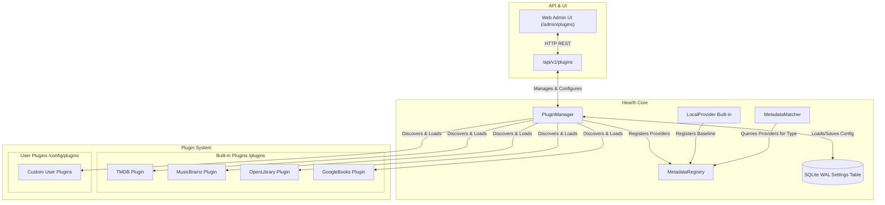
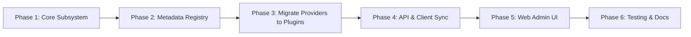

# Hearth Plugin System Architecture & Implementation Plan

This document details the architectural design and implementation plan for introducing a Jellyfin-inspired plugin system to Hearth, with the initial milestone focusing on decoupling all online metadata providers into standalone, configurable plugins.

---

## 1. Goal Description

Hearth is currently designed as a single-node, local-first media server. Today, online metadata providers (**TMDB**, **MusicBrainz**, **Open Library**, **Google Books**) are hardcoded directly into `app/services/metadata/` and tightly coupled to core settings, database matching logic, and admin UI forms.

### Objectives
1. **Jellyfin-Inspired Plugin Architecture**: Establish a modular plugin lifecycle (discovery, manifest parsing, dynamic loading, isolated configuration, and capability registration).
2. **Decouple Online Metadata Providers**: Move TMDB, MusicBrainz, Open Library, and Google Books out of the core server into individual plugins, while keeping `LocalProvider` (NFO, OPF, embedded tags) in core as the foundational baseline.
3. **Pluggable Metadata Registry**: Allow `MetadataMatcher` to dynamically query active plugins by media type (`movie`, `series`, `artist`, `album`, `book`) rather than hardcoding provider branches.
4. **Unified Plugin Management API**: Expose `/api/v1/plugins` for administrative management (list, inspect, configure, enable/disable, hot-reload).
5. **Modern Admin Web UI**: Provide a dedicated "Plugins" dashboard in the web client modeled after Jellyfin Server's plugin management, with rich configuration modals and status indicators.

---

## 2. Architectural Design



### 2.1 Jellyfin Concepts vs. Hearth Implementation

| Concept | Jellyfin Server (.NET) | Hearth (Python / FastAPI) |
| :--- | :--- | :--- |
| **Plugin Interface** | `IPlugin`, `BasePlugin<TConfiguration>` | `BasePlugin`, `PluginContext` |
| **Manifest** | Assembly metadata / `manifest.json` | `plugin.json` (JSON schema validated) |
| **Provider Contracts** | `IMovieMetadataProvider`, `ISeriesMetadataProvider`, etc. | `MetadataProviderPlugin` implementing `MetadataProvider` |
| **Plugin Storage** | `/plugins/{PluginName}/{PluginName}.dll` | Built-in: `/app/plugins/{name}/`<br>User: `/config/plugins/{name}/` |
| **Configuration** | `plugins/configurations/{PluginName}.xml` | `settings` table in SQLite (`plugin.<id>` JSON object) |
| **Extension Discovery**| MEF / Dependency Injection container | `PluginManager` using Python dynamic module import (`importlib`) |
| **Admin UI** | Dashboard -> Plugins (Catalog, Installed) | Admin -> Plugins (`/admin/plugins`) |

### 2.2 Agreed Architectural Decisions

1. **Plugin Storage Directory Layout**:
   - **Built-in Plugins**: `/app/plugins` (shipped within repository and Docker image).
   - **User / Custom Plugins**: `/config/plugins` (mapped to `HEARTH_DATA_DIR/plugins` on the persistent writable volume).
2. **Metadata Provider Priority & Ordering (Per-Library)**:
   - Jellyfin-style per-library configuration. Each library stores its prioritized list of active metadata providers.
   - During scanning and matching, `MetadataMatcher` consults the library's specific provider priority order, with unconfigured libraries falling back to the server-wide default order.
3. **Admin UI Navigation (Unified)**:
   - `/admin/metadata` is fully superseded by `/admin/plugins`.
   - The admin sidebar replaces "Metadata" with "Plugins", presenting a unified dashboard for all installed plugins (metadata providers, notification dispatchers, API adapters, scrobblers).
4. **Third-Party Plugin Dependency Strategy (Option 4A - Shared Runtime & Vendoring)**:
   - Plugins run within Hearth's shared Python runtime (`httpx`, `pydantic`, `sqlalchemy`, `pillow`, `uvloop`, stdlib).
   - Any third-party pure-Python dependencies can be vendored directly in `plugins/<plugin_id>/vendor/` and are automatically prepended to `sys.path` upon plugin load.
   - Preserves Hearth's read-only root filesystem security guarantee and ensures zero startup latency without requiring `pip` or compilation toolchains at runtime.

---

## 3. Detailed Specifications

### 3.1 Plugin Manifest (`plugin.json`)

Every plugin contains a `plugin.json` descriptor in its root directory:

```json
{
  "id": "org.hearth.plugins.tmdb",
  "name": "TheMovieDb",
  "version": "1.0.0",
  "description": "Fetches movie and TV series metadata, artwork, and cast from TMDB.",
  "author": "Hearth Team",
  "category": "Metadata",
  "min_hearth_version": "1.0.0",
  "entrypoint": "plugin:TMDBPlugin",
  "capabilities": [
    "metadata.movie",
    "metadata.series"
  ],
  "config_schema": {
    "title": "TMDBConfig",
    "type": "object",
    "properties": {
      "api_key": {
        "title": "API Key",
        "type": "string",
        "description": "TMDB v3 API Key or v4 Read Access Token",
        "secret": true
      },
      "include_adult": {
        "title": "Include Adult",
        "type": "boolean",
        "default": false
      },
      "preferred_language": {
        "title": "Preferred Language",
        "type": "string",
        "default": "en-US"
      }
    },
    "required": ["api_key"]
  }
}
```

### 3.2 Core Plugin Base Classes (`app/core/plugins/`)

```python
from abc import ABC, abstractmethod
from dataclasses import dataclass
from typing import Any, Generic, TypeVar
from pydantic import BaseModel
from sqlalchemy.ext.asyncio import AsyncSession, async_sessionmaker
from app.core.config import Settings
import logging


class PluginCapability:
    # Metadata Providers
    METADATA_MOVIE = "metadata.movie"
    METADATA_SERIES = "metadata.series"
    METADATA_MUSIC = "metadata.music"
    METADATA_BOOK = "metadata.book"

    # Event Notifications (Discord, Webhooks, Gotify, Telegram)
    NOTIFICATION = "notification"

    # API Adapters & Protocols (Subsonic, Jellyfin, OpenSubtitles)
    API_ROUTER = "api.router"

    # Scrobblers (ListenBrainz, Last.fm, Trakt)
    SCROBBLER = "scrobbler"


@dataclass
class PluginContext:
    settings: Settings
    sessionmaker: async_sessionmaker[AsyncSession]
    logger: logging.Logger
    data_dir: Path


TConfig = TypeVar("TConfig", bound=BaseModel)


class BasePlugin(ABC, Generic[TConfig]):
    manifest: PluginManifest
    enabled: bool = True

    def __init__(self, context: PluginContext) -> None:
        self.context = context
        self.config: TConfig | None = None

    async def initialize(self) -> None:
        """Called once when plugin is loaded."""
        pass

    async def dispose(self) -> None:
        """Called when plugin is unloaded or disabled."""
        pass

    def apply_configuration(self, config_data: dict[str, Any]) -> None:
        """Parse and apply new configuration."""
        pass
```

### 3.3 Metadata Provider Plugin Contract

A metadata plugin integrates directly into Hearth's `MetadataRegistry`:

```python
class MetadataPlugin(BasePlugin[TConfig], MetadataProvider, ABC):
    """A plugin that acts as a metadata provider."""

    @property
    @abstractmethod
    def supported_media_types(self) -> tuple[str, ...]:
        """e.g. ('movie', 'series') or ('music',) or ('book',)"""
        ...
```

### 3.4 Notification Service Plugin Contract

A notification plugin listens to server events (media added, playback events, scans completed, transcode errors):

```python
@dataclass
class ServerEvent:
    event_type: str  # "media.added", "playback.start", "scan.completed", etc.
    payload: dict[str, Any]
    timestamp: datetime


class NotificationPlugin(BasePlugin[TConfig], ABC):
    """A plugin that dispatches notifications to external channels."""

    @abstractmethod
    async def on_event(self, event: ServerEvent) -> None:
        """Handle server event asynchronously."""
        ...
```

### 3.5 API Adapter Plugin Contract (Subsonic, Jellyfin Client Compatibility)

Plugins can expose their own HTTP router directly on FastAPI:

```python
from fastapi import APIRouter


class ApiAdapterPlugin(BasePlugin[TConfig], ABC):
    """A plugin that exposes custom API routes (e.g. Subsonic /rest or Jellyfin endpoints)."""

    @abstractmethod
    def get_router(self) -> APIRouter:
        """Return the FastAPI APIRouter to mount on the server."""
        ...
```
During server startup, `PluginManager.mount_plugin_routes(app)` iterates over active `ApiAdapterPlugin` instances and mounts their routers (e.g. `/rest` for Subsonic clients like DSub, Symfonium, Feishin, or `/jellyfin` compatibility shims).

### 3.6 Scrobbler Plugin Contract (ListenBrainz, Trakt, Last.fm)

```python
class ScrobblerPlugin(BasePlugin[TConfig], ABC):
    """A plugin that scrobbles playback progress and completion."""

    @abstractmethod
    async def now_playing(self, user_id: str, item_id: str, position_seconds: float) -> None: ...

    @abstractmethod
    async def scrobble(self, user_id: str, item_id: str, completed_at: datetime) -> None: ...
```

### 3.4 Dynamic Discovery and Safe Loading

The `PluginManager` handles discovery:
1. **Search Paths**:
   - `HEARTH_BUILTIN_PLUGINS_DIR` (defaults to `<repo>/plugins` or `/app/plugins`).
   - `HEARTH_PLUGINS_DIR` (defaults to `<HEARTH_DATA_DIR>/plugins` or `/config/plugins`).
2. **Loading Sequence**:
   - Parse and validate `plugin.json`.
   - Ensure compatibility (`min_hearth_version <= current_version`).
   - Import module using `importlib.util.spec_from_file_location`.
   - Instantiate plugin class with `PluginContext`.
   - Load persisted config from SQLite `settings` table (`key="plugin:<id>"`).
   - If enabled and valid, call `await plugin.initialize()`.
   - Register provider into `MetadataRegistry`.
3. **Fault Isolation**:
   - If a plugin fails during initialization, its status becomes `Status.FAILED` with a detailed error message in the API/logs.
   - Core server operation, scanner, and other plugins remain completely unaffected.

---

## 4. Phase-by-Phase Implementation Plan



### Phase 1: Core Plugin Subsystem [Completed]
- **Create `app/core/plugins/`**:
  - `manifest.py`: Pydantic model for `plugin.json` (validates metadata, author, capabilities, config schema).
  - `base.py`: `BasePlugin`, `PluginContext`, `PluginStatus` enum (`ACTIVE`, `DISABLED`, `FAILED`, `CONFIG_REQUIRED`).
  - `manager.py`: `PluginManager` implementing discovery, dynamic importing, config loading/saving, and state persistence.
  - `config.py`: Add `HEARTH_PLUGINS_DIR` and `HEARTH_BUILTIN_PLUGINS_DIR` settings to `app/core/config.py`.
- **Database Integration**:
  - Store plugin configuration and enabled state in existing SQLite `settings` table with key `plugin.<plugin_id>`.
  - Sensitive configuration values (marked with `"secret": true` in the schema) are masked when retrieved for the UI and decrypted/stored safely.

### Phase 2: Metadata Registry & Decouple `MetadataMatcher` [Completed]
- **Create `app/services/metadata/registry.py`**:
  - `MetadataRegistry`: Holds active metadata providers mapped by media type (`movie`, `series`, `artist`, `album`, `book`).
  - `LocalProvider` is registered as the default local fallback.
  - Methods: `get_providers_for(media_type: str, library_id: str | None = None, priority_order: Sequence[str] | None = None) -> list[MetadataProvider]`.
  - Library-level priority persistence (`load_library_provider_order`, `save_library_provider_order`) with registry cache priming.
- **Refactor `app/services/metadata/matching.py`**:
  - Remove direct hardcoded imports of `TMDBProvider`, `MusicBrainzProvider`, `OpenLibraryProvider`, `GoogleBooksProvider`.
  - Pass `MetadataRegistry` to `MetadataMatcher`.
  - Replace hardcoded `self._tmdb`, `self._musicbrainz`, etc., with dynamic queries to `registry.get_providers_for(...)`.
  - Prioritize providers using library-level configuration (e.g., Manga vs. Novels having distinct provider priorities), falling back to server default.
- **Factory & Endpoint Decoupling**:
  - Refactored `build_metadata_matcher` in `app/services/metadata/factory.py` to register providers in `MetadataRegistry`.
  - Updated `/api/v1/metadata/search` endpoint in `app/api/v1/metadata.py` to use `registry.get_providers_for(media_type)`.

### Phase 3: Move Online Metadata Providers to Standalone Plugins [Completed]
- **Directory Structure**:
  ```text
  plugins/
    tmdb/
      plugin.json
      plugin.py
      client.py
    musicbrainz/
      plugin.json
      plugin.py
      client.py
    openlibrary/
      plugin.json
      plugin.py
    googlebooks/
      plugin.json
      plugin.py
  ```
- **Migrate Code & Settings**:
  - Moved logic from `app/services/metadata/tmdb.py` to `plugins/tmdb/`.
  - Moved logic from `app/services/metadata/musicbrainz.py` to `plugins/musicbrainz/`.
  - Moved logic from `app/services/metadata/openlibrary.py` to `plugins/openlibrary/`.
  - Moved logic from `app/services/metadata/googlebooks.py` to `plugins/googlebooks/`.
  - Each plugin exports its own typed Pydantic configuration class (`TMDBConfig`, `MusicBrainzConfig`, `OpenLibraryConfig`, `GoogleBooksConfig`).
  - Maintained backward compatibility for environment variables (`HEARTH_TMDB_API_KEY`, `HEARTH_GOOGLE_BOOKS_API_KEY`, etc.) as initial defaults for plugin configs.
  - Provided lightweight backward-compatible adapter classes in `app/services/metadata/` to preserve all existing test suites and imports.
  - Added unit test suite in `tests/unit/test_metadata_plugins.py` verifying discovery, schema parsing, typed configs, and registry registration.

### Phase 4: API Endpoints & Client Sync [Completed]
- **Implement `app/api/v1/plugins.py`**:
  - `GET /api/v1/plugins`: List all discovered plugins, versions, categories, capabilities, status, and whether configuration is valid.
  - `GET /api/v1/plugins/{plugin_id}`: Detailed manifest and JSON schema for settings.
  - `GET /api/v1/plugins/{plugin_id}/config`: Current configuration values with secrets masked.
  - `PUT /api/v1/plugins/{plugin_id}/config`: Save updated configuration; triggers plugin reconfiguration.
  - `POST /api/v1/plugins/{plugin_id}/enable`: Enable plugin.
  - `POST /api/v1/plugins/{plugin_id}/disable`: Disable plugin and unregister from active registry.
  - `POST /api/v1/plugins/reload`: Rescan plugin directories from disk.
- **Backward-Compatible Compatibility Layer**:
  - Adapted existing `/api/v1/admin/metadata/settings` to delegate to the new plugin configuration manager, ensuring no breakages for existing automation scripts.
- **Client Synchronization**:
  - Ran `export_openapi.py` and `generate_client.py` updating `docs/openapi.json` and `packages/client/src/schema.d.ts`.

### Phase 5: Web UI Admin Experience (`/admin/plugins`) [Completed]
- **New Admin Route `web/src/routes/admin/plugins/`**:
  - **Plugins Overview**: Grid of installed plugins with badges:
    - Status: `Active`, `Disabled`, `Error`, `Configuration Required`.
    - Capabilities badges (e.g., "Movie Metadata", "TV Metadata", "Music Metadata", "Book Metadata").
    - One-click Enable / Disable toggle button.
    - Hot-reload button calling `POST /api/v1/plugins/reload`.
  - **Plugin Configuration Modal (`PluginConfigModal.svelte`)**:
    - Dynamically generates settings forms based on the plugin's configuration schema (`properties`, `type`, `secret`, `default`, `enum`).
    - Secret masking: Shows masked hints (e.g. `Configured (…abcd)`), toggle secret visibility, and allow clearing/updating secrets.
- **Navigation Update**:
  - Replaced "Metadata" with "Plugins" in `web/src/routes/admin/+layout.svelte` pointing to `/admin/plugins`.
  - Added redirect from `/admin/metadata` to `/admin/plugins`.

### Phase 6: Testing, Documentation & ADR [Completed]
- **Unit & Integration Tests**:
  - Tested manifest validation, bad manifest handling, and missing entrypoint handling.
  - Tested dynamic plugin loading, lifecycle hooks (`initialize`, `dispose`), and error isolation.
  - Tested configuration persistence and masking in SQLite `settings` table.
  - Tested `MetadataMatcher` matching items via plugin-provided providers in `tests/unit/test_metadata_matcher.py`.
  - Tested library-level provider priority ordering overriding default order.
  - Tested plugin enabling/disabling at runtime and graceful fallback to `LocalProvider`.
- **Documentation**:
  - Added `ADR 066: Jellyfin-Style Plugin System and Metadata Provider Decoupling` to `docs/DECISIONS.md`.
  - Documented plugin development guide, manifest specifications, and capability contracts in `docs/PLUGINS.md`.
  - Updated `docs/ARCHITECTURE.md` and `README.md`.

---

## 5. Architectural Considerations

> [!IMPORTANT]
> **Plugin Execution Model**: In Python, plugins running in-process execute with the server's privileges. Unlike Jellyfin (which uses .NET assemblies), Python plugins have full interpreter access. Built-in plugins ship with the container; user plugins mounted in `/config/plugins` will be treated as trusted server extensions.
>
> **Migration of Existing API Keys**: Existing keys stored in the database (`metadata.tmdb_api_key`, `metadata.google_books_api_key`) or environment variables will be migrated automatically into the respective plugin configurations on first startup so no manual re-entry is required.

---

## 6. Verification Plan

### Automated Tests
- Run full unit tests:
  ```bash
  uv run pytest tests/unit/test_plugins.py tests/unit/test_metadata_registry.py tests/unit/test_metadata_matcher.py
  ```
- Run full test suite:
  ```bash
  uv run pytest
  ```
- Static analysis & type checking:
  ```bash
  uv run ruff format --check
  uv run ruff check
  uv run mypy app
  ```
- OpenAPI & Client Drift verification:
  ```bash
  uv run python scripts/export_openapi.py --check
  uv run python scripts/generate_client.py --check
  ```
- Web client validation:
  ```bash
  cd web && npm run check && npm run build
  ```

### Manual Verification
1. Access `http://192.168.0.100:8009/admin/plugins`.
2. Verify all 4 plugins (TMDB, MusicBrainz, Open Library, Google Books) appear loaded and active.
3. Edit TMDB API key in the plugin configuration dialog and save; verify persistence.
4. Disable a plugin (e.g., Google Books) and confirm it is excluded from search/match operations.
5. Trigger manual match on a movie/show/album/book and verify metadata fetching via the active plugin succeeds.
