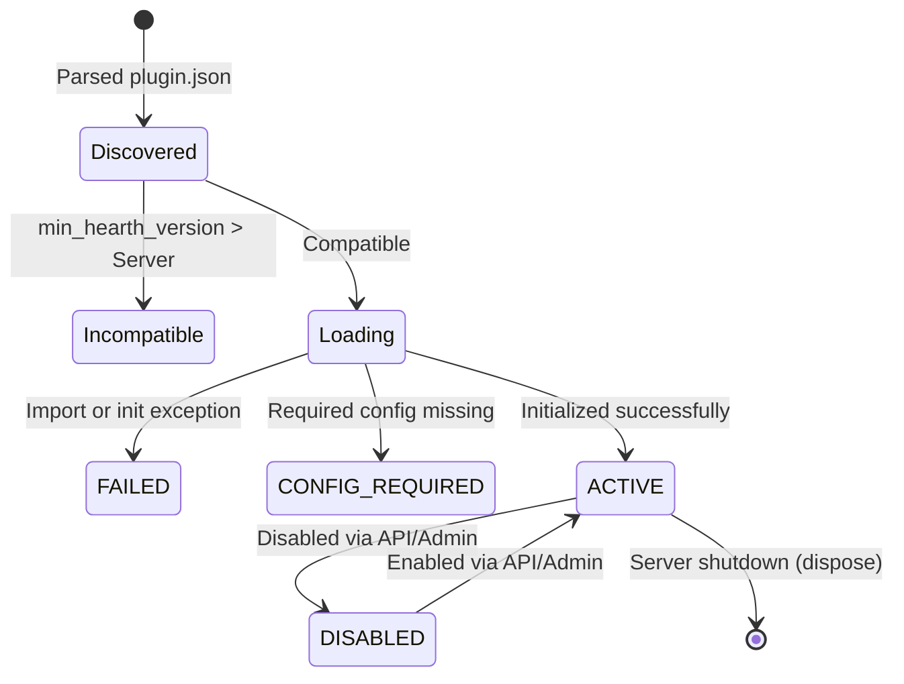

# Plugin System Developer Guide

Hearth features a modular, in-process plugin subsystem inspired by Jellyfin Server. The plugin system decouples external metadata providers (TMDB, MusicBrainz, Open Library, Google Books) from core server logic and allows adding custom integrations—including notification dispatchers, client API adapters, and scrobblers.

---

## 1. Overview & Architecture

### 1.1 Design Principles

- **In-Process Shared Runtime**: Plugins execute inside Hearth's Python runtime, sharing standard asynchronous infrastructure (`httpx`, `sqlalchemy`, `pydantic`, `fastapi`, `asyncio`).
- **Fault Isolation**: If a plugin fails during initialization or runtime calls, its status becomes `failed` without crashing Hearth or interrupting other plugins or background scan jobs.
- **Contract-Driven Manifests**: Every plugin declares its identity, version compatibility, entrypoint, capabilities, and configuration options through a declarative `plugin.json` manifest.
- **Dynamic Registry**: Capabilities such as metadata matching query the server's `MetadataRegistry` dynamically by media type and library-specific priority ordering.

### 1.2 Directory Layout

Hearth scans two distinct directories for plugins:

| Location | Default Path | Purpose |
| :--- | :--- | :--- |
| **Built-in Plugins** | `<repo>/plugins/` (or `/app/plugins` in container) | Shipped with Hearth; read-only. |
| **Custom User Plugins** | `<data_dir>/plugins/` (or `/config/plugins` in container) | User-installed custom plugins on the persistent writable volume. |

Each plugin resides in its own subdirectory containing at minimum `plugin.json` and the Python entrypoint:

```text
plugins/
  my_plugin/
    plugin.json         # Manifest and JSON Schema definition
    plugin.py           # BasePlugin implementation entrypoint
    client.py           # Optional helper logic or HTTP clients
    vendor/             # Optional bundled pure-Python wheels / packages
```

---

## 2. Manifest Specification (`plugin.json`)

Every plugin directory must contain a valid `plugin.json` file conforming to the `PluginManifest` schema.

### 2.1 Manifest Schema Example

```json
{
  "id": "org.example.plugins.custommeta",
  "name": "Custom Metadata Provider",
  "version": "1.0.0",
  "description": "Enriches movie catalog with custom community metadata.",
  "author": "Community Contributor",
  "category": "Metadata",
  "min_hearth_version": "1.0.0",
  "entrypoint": "plugin:CustomMetaPlugin",
  "capabilities": [
    "metadata.movie"
  ],
  "config_schema": {
    "title": "CustomMetaConfig",
    "type": "object",
    "properties": {
      "api_key": {
        "title": "API Key",
        "type": "string",
        "description": "Authentication token for the metadata service.",
        "secret": true
      },
      "include_extras": {
        "title": "Include Extra Content",
        "type": "boolean",
        "default": false
      },
      "rate_limit_rps": {
        "title": "Requests per Second",
        "type": "integer",
        "default": 5,
        "minimum": 1,
        "maximum": 20
      }
    },
    "required": ["api_key"]
  }
}
```

### 2.2 Manifest Fields

| Field | Type | Description |
| :--- | :--- | :--- |
| `id` | `string` | Unique reverse-DNS identifier (e.g. `org.hearth.plugins.tmdb`). Must match `^[a-z0-9]+(\.[a-z0-9_-]+)+$`. |
| `name` | `string` | Human-readable plugin name displayed in the UI. |
| `version` | `string` | Semantic version string (e.g. `1.0.0`). |
| `description` | `string` | Short summary of what the plugin does. |
| `author` | `string` | Author name or organization. |
| `category` | `string` | Category grouping (e.g. `Metadata`, `Notifications`, `Adapters`, `Scrobblers`). |
| `min_hearth_version`| `string` | Minimum required Hearth version for compatibility. |
| `entrypoint` | `string` | File and class name separated by a colon (`<module>:<ClassName>`). |
| `capabilities` | `list[str]` | List of capability identifiers provided by this plugin. |
| `config_schema` | `object` | Standard JSON Schema object describing user-configurable options. |

---

## 3. Plugin Base Classes & Lifecycle

### 3.1 Plugin Lifecycle



1. **Discovery**: On server startup (or via `POST /api/v1/plugins/reload`), Hearth scans plugin directories, parses `plugin.json`, and verifies `min_hearth_version`.
2. **Import & Instantiation**: Loads the entrypoint class and instantiates it with `PluginContext`.
3. **Configuration**: Restores saved settings from SQLite `settings` table (`plugin.<id>`). If required fields are absent, plugin enters `CONFIG_REQUIRED` status.
4. **Initialization**: If enabled, `await plugin.initialize()` is called.
5. **Registration**: Active capabilities are registered into the server (e.g. `MetadataRegistry`).
6. **Disposal**: When disabled, hot-reloaded, or on server shutdown, `await plugin.dispose()` is executed to cleanly release connections and background tasks.

### 3.2 Base Classes

```python
from app.core.config import Settings
from app.core.plugins.base import BasePlugin, PluginContext, PluginStatus
from pydantic import BaseModel, Field
from sqlalchemy.ext.asyncio import AsyncSession, async_sessionmaker


class MyConfig(BaseModel):
    api_key: str = ""
    include_extras: bool = False


class MyPlugin(BasePlugin[MyConfig]):
    def __init__(self, context: PluginContext) -> None:
        super().__init__(context)
        self.config = MyConfig()

    async def initialize(self) -> None:
        """Called once when plugin is loaded and enabled."""
        self.context.logger.info("Initializing MyPlugin")

    async def dispose(self) -> None:
        """Called when plugin is unloaded or disabled."""
        self.context.logger.info("Disposing MyPlugin")

    def apply_configuration(self, config_data: dict[str, Any]) -> None:
        """Called when configuration is loaded or updated."""
        self.config = MyConfig.model_validate(config_data)
```

---

## 4. Capability Contracts

### 4.1 Metadata Providers (`metadata.*`)

Metadata plugins subclass `MetadataPlugin` and implement search and detail methods:

```python
from app.core.plugins.base import MetadataPlugin
from app.services.metadata.base import (
    MovieMetadata,
    ProviderImage,
    SearchResult,
)


class CustomMoviePlugin(MetadataPlugin[MyConfig]):
    name = "custommeta"
    supported_media_types = ("movie",)

    @property
    def enabled(self) -> bool:
        return self.status == PluginStatus.ACTIVE

    async def search(self, query: str, year: int | None = None) -> list[SearchResult]:
        # Return candidate matches
        return [SearchResult(provider=self.name, provider_id="123", title=query, year=year)]

    async def fetch_details(self, provider_id: str) -> MovieMetadata | None:
        # Return full details for matched candidate
        return MovieMetadata(
            provider=self.name,
            provider_id=provider_id,
            title="Example Title",
            year=2024,
            overview="Description of media item",
        )

    async def fetch_images(self, provider_id: str) -> list[ProviderImage]:
        return []
```

### 4.2 Notification Services (`notification`)

```python
from app.core.plugins.base import BasePlugin, ServerEvent


class DiscordNotifierPlugin(BasePlugin[DiscordConfig]):
    async def on_event(self, event: ServerEvent) -> None:
        if event.event_type == "media.added":
            # Dispatch webhook notification
            await self._send_discord_message(event.payload)
```

### 4.3 Client API Adapters (`api.router`)

```python
from app.core.plugins.base import ApiAdapterPlugin
from fastapi import APIRouter


class SubsonicShimPlugin(ApiAdapterPlugin[SubsonicConfig]):
    def get_router(self) -> APIRouter:
        router = APIRouter(prefix="/rest", tags=["Subsonic API"])

        @router.get("/ping.view")
        async def ping():
            return {"subsonic-response": {"status": "ok", "version": "1.16.1"}}

        return router
```

---

## 5. Dependency Vendoring (Option 4A)

Hearth enforces a read-only root filesystem in container deployments for security. Therefore, plugins must **not** invoke `pip install` at runtime.

Instead, pure-Python dependencies can be vendored directly in the plugin directory under `vendor/`:

```text
plugins/
  my_plugin/
    plugin.json
    plugin.py
    vendor/
      some_library/
        __init__.py
```

When `PluginManager` discovers the plugin, `<plugin_dir>/vendor` is automatically prepended to `sys.path`.

---

## 6. Configuration & Secret Masking

### 6.1 Secret Fields
Properties in `config_schema` annotated with `"secret": true` are treated as sensitive credentials (API keys, passwords, tokens).
- When clients fetch `/api/v1/plugins/{id}/config`, secrets are masked (e.g. `••••••••abcd`).
- When updating via `PUT /api/v1/plugins/{id}/config`, submitting the unchanged masked value preserves the existing secret. Submitting an empty string `""` clears the secret.

### 6.2 Per-Library Provider Priorities
Operators can customize metadata provider priority on a per-library basis. While `LocalProvider` always parses local NFO/OPF files first, the ordering of remote online plugins can be customized per library (e.g., Manga libraries prioritizing AniList over Google Books).

---

## 7. Administrative API & Web UI

### 7.1 REST API

| Method | Endpoint | Description |
| :--- | :--- | :--- |
| `GET` | `/api/v1/plugins` | List all discovered plugins with runtime statuses. |
| `GET` | `/api/v1/plugins/{plugin_id}` | Retrieve detailed manifest and configuration schema. |
| `GET` | `/api/v1/plugins/{plugin_id}/config` | Retrieve current plugin configuration (secrets masked). |
| `PUT` | `/api/v1/plugins/{plugin_id}/config` | Save updated configuration; triggers runtime reconfiguration. |
| `POST`| `/api/v1/plugins/{plugin_id}/enable` | Enable plugin and register active capabilities. |
| `POST`| `/api/v1/plugins/{plugin_id}/disable` | Disable plugin and unregister capabilities. |
| `POST`| `/api/v1/plugins/reload` | Rescan plugin directories from disk without restarting server. |

### 7.2 Web UI

Administrators can navigate to **Admin -> Plugins** (`/admin/plugins`) to:
- View status chips (`Active`, `Disabled`, `Config Required`, `Failed`).
- Toggle plugins on or off with a single click.
- Launch the schema-driven configuration dialog to update credentials and preferences.
- Trigger hot-reloading from disk.
