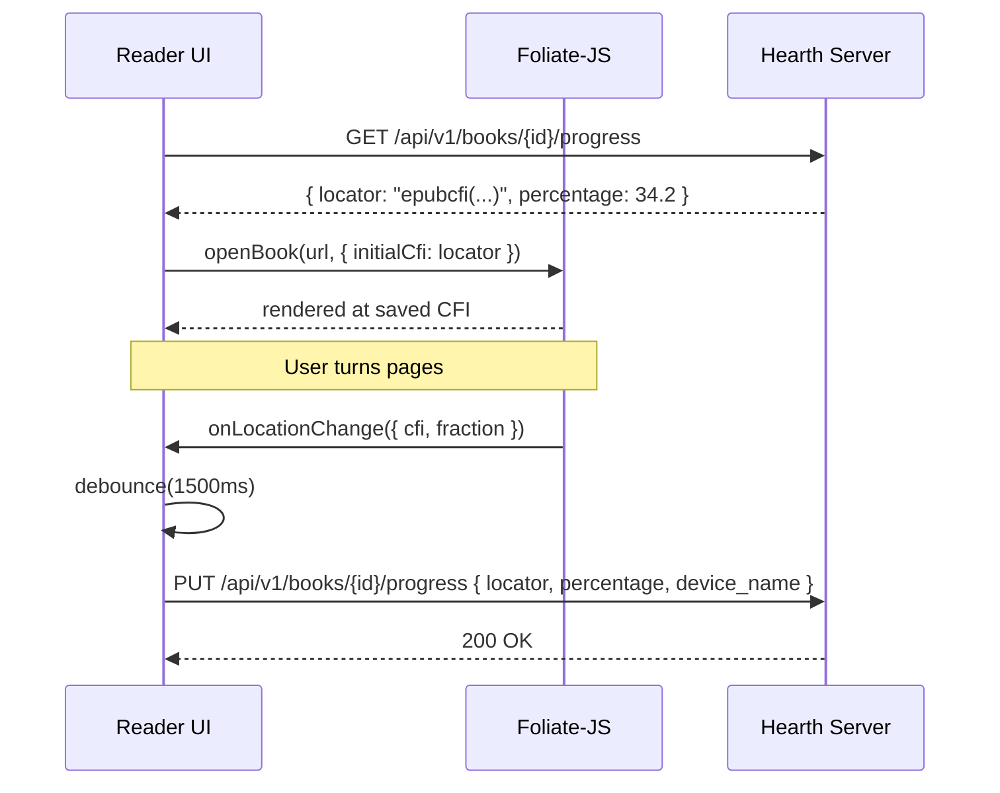

# Hearth Reader Integration Guide (Phase 9 Frontend Reference)

This document specifies the integration architecture, protocols, and recommended frontend libraries for embedding written works (EPUB ebooks, PDF documents, and CBZ/CBR comics and manga) into the Hearth web client in Phase 9.

---

## 1. Architectural Overview

Hearth serves written works through dedicated REST and streaming APIs under `/api/v1/books`. The reader frontend interacts with the server through four primary endpoints:

1. **Book Metadata & Format Discovery**:
   - `GET /api/v1/books/{id}`: Returns book metadata, author, series, page count, and list of available formats (`formats: ["epub", "pdf"]`).
2. **Raw File Streaming & Direct Play**:
   - `GET /api/v1/books/{id}/file/{format}`: Streams the full archive or document with RFC 9110 HTTP Range request support, ETags, and Content-Disposition.
3. **On-Demand Comic Page Serving**:
   - `GET /api/v1/books/{id}/pages/{n}`: On-demand extraction and optional resizing (`?width={width}`) of the nth 1-indexed page from comic archives (CBZ/CBR/PDF) with server-side caching.
4. **Reading Progress Sync**:
   - `GET /api/v1/books/{id}/progress`: Fetches the current user's reading locator, percentage, device, and completion status.
   - `PUT /api/v1/books/{id}/progress`: Persists reading progress using last-write-wins semantics.

### Authentication for Media Elements

Web readers (and iframe/canvas contexts) load assets directly. Hearth provides two authentication methods:
- **Authorization Header**: `Authorization: Bearer <access_token>` for fetch/XHR requests.
- **Media Tokens**: For direct `` src or Web Worker script contexts where custom headers cannot be attached, clients obtain a short-lived media token via `POST /api/v1/auth/media-tokens` (`{"item_id": book_id}`) and pass it as a query parameter:
  ```
  /api/v1/books/{id}/pages/{n}?token={media_token}&width=1200
  /api/v1/books/{id}/file/epub?token={media_token}
  ```

---

## 2. EPUB Reader Integration

### Recommended Library: `foliate-js`

For modern web clients, **`foliate-js`** is strongly recommended over `epub.js`.

| Dimension | `foliate-js` | `epub.js` |
| --- | --- | --- |
| **Architecture** | Modern ES modules, web components, native browser standards | Older codebase, monolithic architecture |
| **CFI Handling** | Fast, robust, handles nested XML structures reliably | Occasional breakage with complex OPF packages |
| **Pagination** | Native CSS multi-column layouts, smooth transitions | Complex custom iframe layout calculations |
| **Performance** | Low memory footprint, fast initial rendering | Higher memory usage, slower spine parsing |
| **Theming** | Direct CSS variable injection into shadow DOM | Cumbersome theme stylesheets |

### Locator Specification: Canonical Fragment Identifier (CFI)

- EPUB progress is stored as an **EPUB CFI string** in `BookProgress.locator`:
  ```
  epubcfi(/6/4[chap01]!/4/2/10)
  ```
- CFIs identify precise structural locations within XHTML content documents, surviving client-side font resize, window dimensions, and zoom level changes.
- **Percentage calculation**:
  - `foliate-js` emits current CFI and fractional progress `[0.0, 1.0]` based on cumulative spine progression.
  - Scale to `percentage = round(fraction * 100.0, 2)`.

### Lifecycle & Progress Flow



---

## 3. PDF Reader Integration

### Recommended Library: `pdf.js` (Mozilla)

- Use official `@mozilla/pdfjs-dist` with worker thread enabled (`pdf.worker.min.js`).
- Render options:
  - **Canvas Mode**: Crisp rendering, pinch-to-zoom, hardware accelerated.
  - **Text Layer**: Overlay invisible text for copy-paste and search highlighting.

### Locator Specification

- PDFs use stringified page coordinates in `BookProgress.locator`:
  ```
  page:42
  ```
  Or structured JSON for exact scroll offsets:
  ```json
  {"page": 42, "offset_y": 320, "zoom": 1.25}
  ```
- **Percentage calculation**:
  ```
  percentage = round((current_page / total_pages) * 100.0, 2)
  ```

---

## 4. Comic & Manga Reader Integration (CBZ / CBR)

### Custom Virtualized Canvas & Prefetching Pipeline

Comics require high-resolution image rendering, zero stutter during page turns, and flexible layout modes (single page, dual page spread, vertical webtoon scroll).

Rather than downloading multi-hundred-megabyte CBZ archives to the browser, the frontend consumes Hearth's on-demand page extraction API:
```
GET /api/v1/books/{id}/pages/{n}?width={container_width}&token={media_token}
```

### Intelligent Prefetch Pipeline

To guarantee instantaneous page flips without network lag:
1. **Window Size**: Keep 5 pages in memory: `[n-2, n-1, current (n), n+1, n+2]`.
2. **Priority Queue**:
   - Immediate: Fetch current page `n`.
   - High Priority: Prefetch `n+1`.
   - Medium Priority: Prefetch `n+2` and `n-1`.
   - Low Priority: Prefetch `n-2`.
3. **Browser Cache Utilization**:
   Hearth responds with `Cache-Control: private, max-age=86400` and `X-Cache: HIT/MISS`. Prefetched pages are served from browser cache upon turning.

### Reading Modes & Direction

- **Left-to-Right (LTR)**: Western comics (Marvel, DC, BD).
- **Right-to-Left (RTL)**: Manga (Japanese, Korean Manhwa in print format).
  - Reverse horizontal swipe / arrow key directions.
- **Vertical Continuous Scroll**: Webtoons and digital manhwa.
  - Virtualized list loading images as they scroll into viewport with 500px pre-render buffer.
- **Dual-Page Spread Detection**:
  - Automatically pair pages when screen aspect ratio > 1.3 (landscape).
  - Page 1 (cover) displayed as single page; subsequent pages paired: `(2,3)`, `(4,5)`.
  - When an image's natural aspect ratio is wide (`width > height`), display as a full double-page spread alone.

---

## 5. Reading Progress Protocol & Conflict Resolution

### Debouncing & Unload Handlers

- **Page Turn Debounce**: Debounce `PUT /api/v1/books/{id}/progress` by **1500 ms** to prevent hammering the server during rapid page skimming.
- **Immediate Sync on Exit**:
  - Listen to `visibilitychange` (`document.visibilityState === "hidden"`) and `beforeunload`.
  - Use `navigator.sendBeacon` or `fetch` with `keepalive: true` to flush pending progress immediately without waiting for debounce timers.

### Conflict Resolution

- Reading progress follows **Last-Write-Wins (LWW)** governed by `BookProgress.updated_at`.
- When switching devices (e.g. from Desktop Web to Mobile Tablet), the reader fetches `GET /api/v1/books/{id}/progress` on mount. If server `updated_at` is newer than local storage, prompt user or automatically resume from the server's locator.

### Auto-Completion

- When `percentage >= 99.0` or user reaches the final page/chapter, `completed: true` is sent.
- Hearth marks the book completed in catalog queries and continues-reading shelves.
