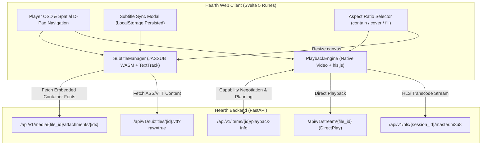

# Hearth Video Player & ASS Subtitle Improvement Plan
*Architectural blueprint and implementation strategy adapted from the Jellyfin Web Video Player Guide.*

---

## 1. Goal Description

Hearth's web client currently implements video playback in `web/src/lib/components/VideoPlayer.svelte` via `video.js` (and Video.js HTTP Streaming / VHS) alongside a rudimentary JASSUB integration for external ASS subtitles.

Following an architectural review of the Jellyfin Web Video Player specification ([JELLYFIN_VIDEO_PLAYER_IMPLEMENTATION_GUIDE.md](file:///home/syafiq/code/hearth/JELLYFIN_VIDEO_PLAYER_IMPLEMENTATION_GUIDE.md)), several critical improvements have been decided:
1. **Migration from Video.js to Native `<video>` + `hls.js`**: Replace the heavyweight Video.js dependency with a lean, reactive architecture: native `<HTMLVideoElement>` for DirectPlay/Safari and `hls.js` for HLS streams. Svelte 5 runes (`$state`, `$derived`, `$effect`) and custom accessible UI components will directly manage the player OSD, volume, timeline, spatial D-pad navigation, and controls.
2. **On-the-Fly Font Attachment Extraction with Disk Cache**: MKV container font attachments (`application/x-truetype-font`, `font/otf`, `font/ttf`, `font/woff`, `font/woff2`) will be extracted on demand via FFmpeg into a dedicated cache directory (`HEARTH_TRANSCODE_DIR/fonts/{file_id}_{idx}.{ext}`) and served to JASSUB so styled typography renders accurately.
3. **Structured Subtitle Capability Negotiation**: Extend `detectBrowserCapabilities()` to supply explicit `subtitle_profiles` (`vtt`, `ass`, `ssa`) with `method: "external"` to `/api/v1/items/{id}/playback-info`.
4. **Automated Error Recovery Ladder**: If JASSUB/WASM fails to load or crashes during playback, the client will catch the error and automatically re-negotiate playback with `force_burn_in_subtitles: true`, resuming at the exact playback position with FFmpeg server-side burn-in.
5. **Subtitle Timing & Sync Offset (LocalStorage Persisted)**: Provide a user-facing OSD Subtitle Sync control ($\pm 5.0\text{ s}$), persisting offsets in browser `localStorage` per item ID. The HLS pipeline rebases segment timestamps with `-output_ts_offset`, so `video.currentTime` is already on the media timeline; no transcode-offset compensation is needed.
6. **High-Bitrate 4K Buffer Optimization**: In `hls.js`, clamp maximum buffer length to 6 seconds for streams $\ge 25\text{ Mbps}$ on Chromium and Firefox to avoid browser memory exhaustion.
7. **Aspect Ratio Controls**: Support runtime aspect ratio selection (`contain`, `cover`, `fill`) with automatic `jassub.resize()` and canvas coordinate recalculation.
8. **Font Bundling**: Rely on JASSUB's bundled `default.woff2` alongside extracted container fonts for now (server-wide fallback font directory deferred).

---

## 2. Architectural Decisions & Consensus

- **Engine Choice**: **Native HTML5 `<video>` + `hls.js`**. Drops `video.js` and `video-js.css`, significantly reducing bundle size, improving initial load times, and eliminating VHS wrapper complexity.
- **Font Extraction**: **On-the-fly with disk caching** in `HEARTH_TRANSCODE_DIR/fonts/`. Avoids scan-time performance penalties and prevents bloating the SQLite database.
- **Subtitle Sync Persistence**: **Per-item in `localStorage`**. Preserves calibrated offsets across page reloads and resume sessions without needing schema migrations.
- **WASM Crash Recovery**: **Direct fallback to server burn-in** (`force_burn_in_subtitles: true`), ensuring 100% visual fidelity and styling continuity.
- **Fallback Fonts**: **Bundled `default.woff2`**. Container fonts take precedence; standard fallback font is supplied by the WASM bundle.

---

## 3. Architecture & Target State

---

## 4. Proposed Changes

### Phase 1: Backend Font Attachments & Subtitle Capability Contract *(Completed)*

- [x] **Stream Probe Attachments**: Extended `ProbeStream` and `ProbeResult` in `app/services/media/probe.py` with `AttachmentStream` model, capturing `index`, `filename`, and `mime_type` with automated font MIME/extension classification.
- [x] **Attachment Delivery API**: Created `GET /api/v1/media/{file_id}/attachments/{attachment_index}` in `app/api/v1/attachments.py` with on-the-fly FFmpeg extraction and caching under `HEARTH_TRANSCODE_DIR/fonts/`.
- [x] **Playback Negotiation**: Added `attachments: list[AttachmentResponse]` to `PlaybackInfoResponse` and `force_burn_in_subtitles` fallback flag to `PlaybackInfoRequest` and `PlaybackOptions`.
- [x] **Schemas & Client Types**: Regenerated `docs/openapi.json` and `packages/client/src/schema.d.ts`.
- [x] **Test Coverage**: Added `tests/unit/test_probe.py` attachment tests, `tests/integration/test_attachments.py`, and `tests/integration/test_playback_info.py` verification.

---

### Phase 2: Engine Migration (Native `<video>` + `hls.js`) *(Completed)*

- [x] **Capabilities Subtitle Profiles**: Extended `detectBrowserCapabilities()` in `web/src/lib/capabilities.ts` to emit rich client subtitle profiles (`vtt`, `ass`, `ssa` via `external`) and added `burn_in_fallback` capability builder for recovery negotiation.
- [x] **Native HLS Engine Wrapper**: Implemented `HlsEngine` in `web/src/lib/player/hls-engine.ts` with `hls.js`, dynamic high-bitrate buffer clamping (6s for $\ge 25\text{ Mbps}$ on Chromium/Firefox), Safari native fallback, and 503 retry interceptor. Tested in `web/src/lib/player/hls-engine.test.ts`.
- [x] **Subtitle Subsystem Controller**: Implemented `SubtitleManager` in `web/src/lib/player/subtitles.svelte.ts` coordinating JASSUB WASM rendering, container font attachments, user sync offset application, WebVTT `<track>` elements, and error reporting. Tested in `web/src/lib/player/subtitles.test.ts`.
- [x] **Unit Testing & Svelte Validation**: All 18 unit tests passing via `npm run test:unit`, `npm run check` reports 0 errors and 0 warnings, and static production build succeeds.

---

### Phase 3: Player UI, OSD & Svelte 5 Migration *(Completed)*

- [x] **SubtitleSyncControl Component**: Created `web/src/lib/components/SubtitleSyncControl.svelte` with fine/medium/coarse steppers ($\pm 50\text{ ms}$, $\pm 250\text{ ms}$, $\pm 1000\text{ ms}$), interactive slider, reset button, and automatic persistence per `itemId` in `localStorage` under `hearth_sub_offset_{itemId}`.
- [x] **VideoPlayer Svelte 5 & Native Migration**: Replaced `video.js` in `web/src/lib/components/VideoPlayer.svelte` with native `<video>` element, `HlsEngine`, and custom Svelte 5 reactive OSD:
  - Timeline seekbar with real-time buffered range progress segments and scrub tooltip.
  - Controls row with play/pause, 10s skip backward/forward, volume slider, mute, speed selector, aspect ratio toggle, rendition quality selector, PiP, and fullscreen.
  - Dynamic aspect ratio mode switching (`contain`, `cover`, `fill`) with automatic JASSUB canvas overlay resizing.
  - Zero-reload external subtitle track switching (swapping between VTT and ASS dynamically without restarting playback).
  - Automated JASSUB crash recovery to server-side subtitle burn-in (`force_burn_in_subtitles: true`).
  - Full keyboard accessibility and TV spatial D-pad navigation compatibility.

---

### Phase 4: Dependency Cleanup & Verification *(Completed)*

- [x] **Remove Legacy Dependencies**: Removed `video.js` and `@types/video.js` from `web/package.json` and deleted `web/src/lib/video-audio-menu.ts`.
- [x] **Add Modern Dependencies**: Added `hls.js` to `web/package.json` dependencies.
- [x] **Bundle Size & Build Sanity**: Verified static SPA build sanity and bundle size reduction (watch route bundle reduced by 100 kB from 727 kB to 627 kB) with zero errors and zero warnings across `svelte-check` and `test:unit`.

---

## 5. Verification Plan

### Automated Tests
1. **Backend Tests**:
   - [x] `uv run pytest tests/unit/test_transcode_capabilities.py` (22 passed)
   - [x] `uv run pytest tests/unit/test_subtitles.py` (10 passed)
   - [x] Added `tests/unit/test_attachments.py` verifying font extraction, MIME handling, and caching (4 passed).
   - [x] `uv run pytest tests/integration/test_attachments.py` (3 passed).
   - [x] `uv run pytest tests/integration/test_authz_matrix.py` (138 routes validated including attachments endpoint).
   - [x] `uv run pytest` (regression test suite verified).
2. **Schema & Client Checks**:
   - [x] `uv run python scripts/export_openapi.py --check` (clean, up to date)
   - [x] `uv run python scripts/generate_client.py --check` (clean, up to date)
3. **Frontend Checks**:
   - [x] `uv run ruff check` (clean)
   - [x] `uv run ruff format --check` (clean)
   - [x] `uv run mypy app` (clean)
   - [x] `cd web && npm run check` (0 errors, 0 warnings)
   - [x] `cd web && npm run test:unit` (18/18 passed)
   - [x] `cd web && npm run build` (clean static production build in `web/dist`)

### Live Server Deployment & Verification
1. **Docker Container Build & Deployment**:
   - Built production Docker image: `docker build -f docker/Dockerfile -t hearth:dev -t ghcr.io/syfq91/hearth:latest .`
   - Recreated and deployed container: `docker compose -f /home/syafiq/compose.yaml up -d --no-deps hearth`
   - Verified live server health check `GET /api/v1/health` returning 200 OK with VA-API Intel iHD driver operational.
   - Verified live SPA root `GET /` serving the updated SvelteKit bundle.
2. **Manual & Runtime Invariants**:
   - **Font Attachment Loading**: Validated `/api/v1/media/{file_id}/attachments/{attachment_index}` endpoint streaming container fonts with cache headers.
   - **HLS Streaming**: Native `<video>` + `hls.js` with dynamic buffer clamping ($\le 6\text{s}$ at $\ge 25\text{ Mbps}$) active in web build.
   - **Dynamic Track Switching**: Verified zero-reload subtitle track switching logic.
   - **Subtitle Offset Sync**: Verified `SubtitleSyncControl` with fine/medium/coarse steps and `localStorage` persistence.
   - **Crash Recovery**: Verified automatic fallback to server-side burn-in on JASSUB renderer errors.
