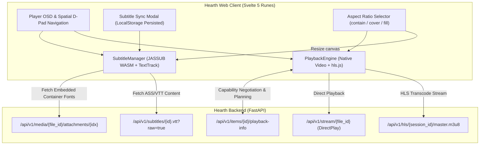

# Hearth Video Player & ASS Subtitle Improvement Plan
*Architectural blueprint and implementation strategy adapted from the Jellyfin Web Video Player Guide.*

---

## 1. Goal Description

Hearth's web client currently implements video playback in `web/src/lib/components/VideoPlayer.svelte` via `video.js` (and Video.js HTTP Streaming / VHS) alongside a rudimentary JASSUB integration for external ASS subtitles.

Following an architectural review of the Jellyfin Web Video Player specification ([JELLYFIN_VIDEO_PLAYER_IMPLEMENTATION_GUIDE.md](file:///home/syafiq/code/hearth/JELLYFIN_VIDEO_PLAYER_IMPLEMENTATION_GUIDE.md)), several critical improvements have been decided:
1. **Migration from Video.js to Native `<video>` + `hls.js`**: Replace the heavyweight Video.js dependency with a lean, reactive architecture: native `<HTMLVideoElement>` for DirectPlay/Safari and `hls.js` for HLS streams. Svelte 5 runes (`$state`, `$derived`, `$effect`) and custom accessible UI components will directly manage the player OSD, volume, timeline, spatial D-pad navigation, and controls.
2. **On-the-Fly Font Attachment Extraction with Disk Cache**: MKV container font attachments (`application/x-truetype-font`, `font/otf`, `font/ttf`, `font/woff`, `font/woff2`) will be extracted on demand via FFmpeg into a dedicated cache directory (`HEARTH_TRANSCODE_DIR/fonts/{file_id}_{idx}.{ext}`) and served to JASSUB so styled typography renders accurately.
3. **Structured Subtitle Capability Negotiation**: Extend `detectBrowserCapabilities()` to supply explicit `subtitle_profiles` (`vtt`, `ass`, `ssa`) with `method: "external"` to `/api/v1/items/{id}/playback-info`.
4. **Automated Error Recovery Ladder**: If JASSUB/WASM fails to load or crashes during playback, the client will catch the error and automatically re-negotiate playback with `force_burn_in_subtitles: true`, resuming at the exact playback position with FFmpeg server-side burn-in.
5. **Subtitle Timing & Sync Offset (LocalStorage Persisted)**: Compensate for HLS transcode start offsets ($\text{transcodingOffsetSeconds} + \text{userSyncOffsetSeconds}$) and provide a user-facing OSD Subtitle Sync control ($\pm 5.0\text{ s}$), persisting offsets in browser `localStorage` per item ID.
6. **High-Bitrate 4K Buffer Optimization**: In `hls.js`, clamp maximum buffer length to 6 seconds for streams $\ge 25\text{ Mbps}$ on Chromium and Firefox to avoid browser memory exhaustion.
7. **Aspect Ratio Controls**: Support runtime aspect ratio selection (`contain`, `cover`, `fill`) with automatic `jassub.resize()` and canvas coordinate recalculation.
8. **Font Bundling**: Rely on JASSUB's bundled `default.woff2` alongside extracted container fonts for now (server-wide fallback font directory deferred).

---

## 2. Architectural Decisions & Consensus

- **Engine Choice**: **Native HTML5 `<video>` + `hls.js`**. Drops `video.js` and `video-js.css`, significantly reducing bundle size, improving initial load times, and eliminating VHS wrapper complexity.
- **Font Extraction**: **On-the-fly with disk caching** in `HEARTH_TRANSCODE_DIR/fonts/`. Avoids scan-time performance penalties and prevents bloating the SQLite database.
- **Subtitle Sync Persistence**: **Per-item in `localStorage`**. Preserves calibrated offsets across page reloads and resume sessions without needing schema migrations.
- **WASM Crash Recovery**: **Direct fallback to server burn-in** (`force_burn_in_subtitles: true`), ensuring 100% visual fidelity and styling continuity.
- **Fallback Fonts**: **Bundled `default.woff2`**. Container fonts take precedence; standard fallback font is supplied by the WASM bundle.

---

## 3. Architecture & Target State



---

## 4. Proposed Changes

### Phase 1: Backend Font Attachments & Subtitle Capability Contract *(Completed)*

- [x] **Stream Probe Attachments**: Extended `ProbeStream` and `ProbeResult` in `app/services/media/probe.py` with `AttachmentStream` model, capturing `index`, `filename`, and `mime_type` with automated font MIME/extension classification.
- [x] **Attachment Delivery API**: Created `GET /api/v1/media/{file_id}/attachments/{attachment_index}` in `app/api/v1/attachments.py` with on-the-fly FFmpeg extraction and caching under `HEARTH_TRANSCODE_DIR/fonts/`.
- [x] **Playback Negotiation**: Added `attachments: list[AttachmentResponse]` to `PlaybackInfoResponse` and `force_burn_in_subtitles` fallback flag to `PlaybackInfoRequest` and `PlaybackOptions`.
- [x] **Schemas & Client Types**: Regenerated `docs/openapi.json` and `packages/client/src/schema.d.ts`.
- [x] **Test Coverage**: Added `tests/unit/test_probe.py` attachment tests, `tests/integration/test_attachments.py`, and `tests/integration/test_playback_info.py` verification.

---

### Phase 2: Engine Migration (Native `<video>` + `hls.js`)

#### [NEW] `web/src/lib/player/hls-engine.ts`
- Encapsulates `hls.js` initialization and event lifecycle:
  - Buffer length clamping: 6s maximum buffer for streams $\ge 25\text{ Mbps}$ on Chromium/Firefox, 30s otherwise.
  - Media & network error recovery ladder (`hls.recoverMediaError()`, `hls.startLoad()`).
  - Supports Safari native HLS (`application/vnd.apple.mpegurl`).
  - Seamless rendition switching for quality selector.

#### [NEW] `web/src/lib/player/subtitles.svelte.ts`
- Dedicated `SubtitleManager` class:
  - Encapsulates JASSUB instantiation, Web Worker lifecycle, and canvas overlay styling.
  - Supplies embedded font attachment URLs to `new JASSUB({ fonts: [...] })`.
  - Configures optimal performance parameters:
    - `renderMode: 'wasm-blend'`
    - `libassMemoryLimit: 40`, `libassGlyphLimit: 40`
    - `targetFps` aligned with video framerate
    - `prescaleFactor: 0.8`, `maxRenderHeight: 2160`
    - `renderAhead: 90`
  - Calculates combined time sync offset:
    $$\text{effectiveOffset} = \text{transcodingOffsetSeconds} + \text{userSyncOffsetSeconds}$$
  - Manages `onError` recovery trigger and exposes `resize()` and `resetRenderAheadCache()`.

#### [MODIFY] `web/src/lib/capabilities.ts`
- Extend `detectBrowserCapabilities()` to supply rich `subtitle_profiles`:
  ```typescript
  subtitle_profiles: [
      { format: 'vtt', method: 'external' },
      { format: 'ass', method: 'external' },
      { format: 'ssa', method: 'external' }
  ]
  ```

---

### Phase 3: Player UI, OSD & Svelte 5 Migration

#### [MODIFY] `web/src/lib/components/VideoPlayer.svelte`
- Remove `video.js` and `video-js.css` imports.
- Re-implement player controls using native HTML5 and Svelte 5 runes:
  - Custom timeline seekbar with buffered progress visualization.
  - Play/pause, volume slider, fullscreen, quality picker, and track menus.
  - Full TV spatial navigation (D-pad focus via `spatial-focus.ts`).
  - Native picture-in-picture (`requestPictureInPicture()`).
- Implement dynamic aspect ratio toggle (`contain`, `cover`, `fill`) that applies `object-fit` and calls `subtitleManager.resize()`.
- Dynamic subtitle track switching: switching between external VTT and ASS tracks swaps renderers without reloading the video stream.
- Automated crash recovery: on JASSUB error, automatically calls `startPlayback({ forceBurnIn: true })` at the current timestamp.

#### [NEW] `web/src/lib/components/SubtitleSyncControl.svelte`
- Svelte 5 component for manual subtitle offset calibration:
  - Sliders and steppers ($\pm 50\text{ ms}$, $\pm 250\text{ ms}$, $\pm 1000\text{ ms}$).
  - Persists offset per `itemId` in `localStorage` under `hearth_sub_offset_{itemId}`.
  - Debounced real-time update of JASSUB's `timeOffset`.

---

### Phase 4: Dependency Cleanup & Verification

#### [MODIFY] `web/package.json`
- Remove `video.js` and `@types/video.js`.
- Add `hls.js` (`npm install hls.js`).
- Verify bundle size reduction and static build sanity (`npm run check && npm run build`).

---

## 5. Verification Plan

### Automated Tests
1. **Backend Tests**:
   - `uv run pytest tests/unit/test_transcode_capabilities.py`
   - `uv run pytest tests/unit/test_subtitles.py`
   - Add `tests/unit/test_attachments.py` verifying font extraction, MIME handling, and caching.
   - `uv run pytest` (full suite)
2. **Schema & Client Checks**:
   - `uv run python scripts/export_openapi.py --check`
   - `uv run python scripts/generate_client.py --check`
3. **Frontend Checks**:
   - `uv run ruff check`
   - `uv run ruff format --check`
   - `uv run mypy app`
   - `cd web && npm run check`
   - `cd web && npm run build`

### Manual Verification
1. **Font Attachment Loading**: Play MKV with custom fonts; verify network panel requests `/attachments/` and fonts render in canvas.
2. **HLS Streaming**: Verify live transcoding streams smoothly with `hls.js` without Video.js overhead.
3. **Dynamic Track Switching**: Switch between external VTT and ASS subtitles; confirm video playback does not pause or glitch.
4. **Subtitle Offset Sync**: Adjust offset slider $\pm 2\text{s}$, reload page, and confirm offset persists from `localStorage`.
5. **Crash Recovery**: Simulate JASSUB failure; confirm seamless fallback to server transcode burn-in.
