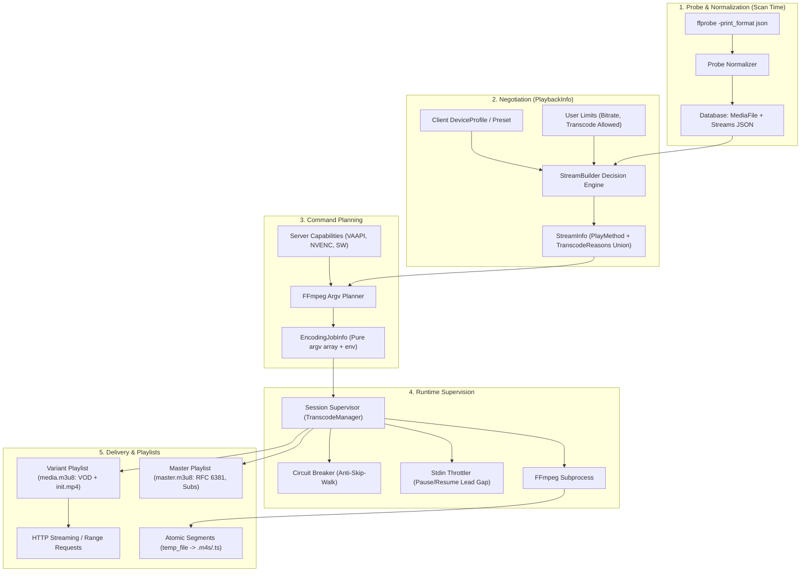
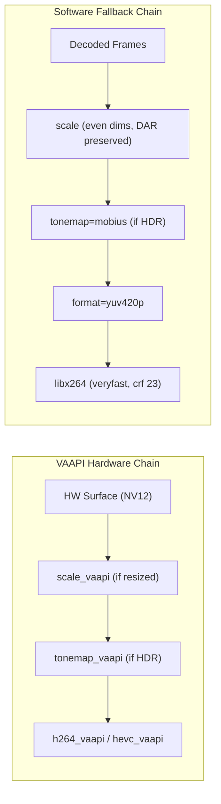
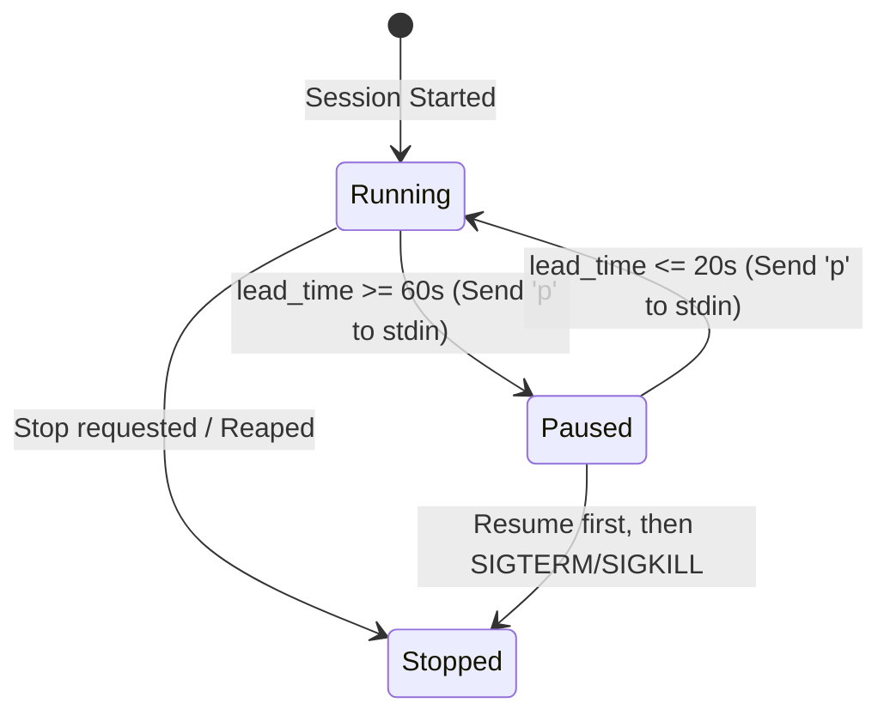
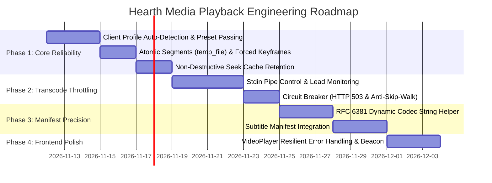

# Video Playback & Transcoding Architecture: Reference & Hearth Improvement Plan

This document synthesizes the video playback and transcoding architectures from Jellyfin/Ferrofin (`ferrofin_transcoding.md` and `ferrofin_video_playback.md`), conducts a gap analysis against Hearth's current implementation, and establishes a comprehensive engineering blueprint to upgrade Hearth's media streaming and transcoding engine to production-grade reliability, efficiency, and compatibility.

---

## 1. Executive Summary & Core Mental Model

The media streaming subsystem exists to make a single guarantee to any client:
> **"Give me your device capabilities, and I will negotiate the optimal playback path (Direct Play, Remux, or Transcode), stream the media seamlessly, adapt dynamically to seeking and network conditions, and cleanly reclaim server compute and storage."**

### 1.1 The Five-Stage Lifecycle



### 1.2 Decision Hierarchy: The Three Play Methods

1. **DirectPlay (`PlayMethod::DirectPlay`)**:
   - The container, video codec/profile/level, and audio codec/channels are natively supported by the client, and the source bitrate is within client and user bandwidth limits.
   - Served directly over HTTP range requests (`/api/v1/stream/{file_id}`) with zero server CPU/GPU overhead.
2. **DirectStream / Remux (`PlayMethod::DirectStream` or `remux_hls`)**:
   - The video stream is natively supported, but the container (e.g. MKV on Safari/Chrome) or the audio track (e.g. DTS/TrueHD) is incompatible with direct playback.
   - The video stream is copied without re-encoding (`-c:v copy`), while audio is transcoded (e.g. to AAC/Opus) and remuxed into an HLS fMP4 or TS container on the fly.
3. **Transcode (`PlayMethod::Transcode` or `transcode_hls`)**:
   - The video codec, profile, level, bit depth, or bitrate exceeds client or user capabilities, or subtitle burn-in is required.
   - Both video and audio are transformed by ffmpeg (using hardware acceleration where available) into a compliant stream.

### 1.3 Universal Ground Rules

- **Time Units**: Internal seek offsets and media positions in modern streaming servers are tracked in high-precision units (Ferrofin uses 100 ns ticks: 10,000,000 ticks/sec; Hearth uses floating-point seconds and milliseconds). Conversions must remain consistent across database, DTOs, and playlist timestamps.
- **Session Identification**: Every playback negotiation mints a unique `session_id` (or `PlaySessionId`). All progress reports, keepalives, segment requests, and cancellation commands must echo this identifier.
- **Media Token Security**: Video and audio elements cannot send custom HTTP headers (such as `Authorization: Bearer <token>`). Endpoints authenticate via short-lived, HMAC-signed media tokens (`?token=...`) scoped specifically to the user and item.
- **Case-Insensitive Query Binding**: Player implementations vary across web, mobile, and smart TVs (`VideoBitrate` vs `videoBitRate`). The backend must bind query arguments case-insensitively to prevent dropping negotiated limits.

---

## 2. Media Probing & Normalization Architecture

Probing must occur **at scan time**, never during a user request. The server must persist normalized stream metadata so negotiation can evaluate candidates instantly without disk I/O.

### 2.1 Extraction Rules

`ffprobe` is executed with arguments:
```bash
ffprobe -i <path> -threads 0 -v warning -print_format json -show_streams -show_format -show_chapters
```

The resulting JSON is normalized into strict data structures:
- **Video Streams**: Codec, profile, level, width, height, aspect ratio (SAR/DAR), frame rate (r_frame_rate vs avg_frame_rate), bit depth (inferred from `pix_fmt`, e.g. `yuv420p` = 8-bit, `yuv420p10le` = 10-bit), color space, color primaries, color transfer (e.g. `smpte2084` for PQ, `arib-std-b67` for HLG), Dolby Vision configuration record (profile, level, RPU present), HDR10+ metadata, and field order (interlaced vs progressive).
- **Audio Streams**: Codec, profile, channel count, channel layout (e.g. `5.1(side)`, `stereo`), sample rate, bit rate, language, and dispositions (`default`, `forced`, `hearing_impaired`).
- **Subtitle Streams**: Codec (`subrip`, `ass`, `webvtt`, `hdmv_pgs_subtitle`, `dvd_subtitle`), language, title, and dispositions.
- **Attachments**: Font files (`.ttf`, `.otf`) embedded in MKV containers extracted for subtitle rendering.

### 2.2 Unknown Heuristics & Pitfalls

- **Do Not Fabricate Unknowns**: If `ffprobe` does not report a video level or width, leave it as `null` rather than fabricating arbitrary defaults that poison the decision engine.
- **Unknown Bitrate Assumption**: If a file lacks container or video bitrate metadata, assume a conservative default of **40 Mbps** during bandwidth checks. Assuming a lower default (like 5 Mbps) causes high-bitrate files to be incorrectly negotiated as Direct Play over constrained connections, leading to severe client buffering.

---

## 3. Client Capabilities & Decision Engine (Negotiation)

The decision engine is a **pure function**:
```text
(ClientProfile, MediaSourceInfo, UserLimits, RequestOverrides) -> TranscodePlan
```

### 3.1 DeviceProfile Specification

A client reports its decode capabilities via a structured profile:
```json
{
  "containers": ["mp4", "webm", "mkv"],
  "video_codecs": [
    {"codec": "h264", "profiles": ["baseline", "main", "high"], "max_level": 51},
    {"codec": "hevc", "profiles": ["main", "main 10"], "max_level": 150},
    {"codec": "av1", "profiles": ["main"], "max_level": 19}
  ],
  "audio_codecs": [
    {"codec": "aac", "max_channels": 6},
    {"codec": "opus", "max_channels": 6},
    {"codec": "ac3", "max_channels": 6},
    {"codec": "eac3", "max_channels": 8}
  ],
  "subtitle_profiles": [
    {"format": "vtt", "method": "External"},
    {"format": "ass", "method": "External"},
    {"format": "pgs", "method": "Encode"}
  ],
  "max_width": 3840,
  "max_height": 2160,
  "max_bitrate": 50000000,
  "hdr": true,
  "hls_fmp4": true
}
```

### 3.2 The Union of Transcode Reasons

Rather than halting at the first failure, the decision engine computes the complete **union** of failure reasons using bitflags or standardized string enums:

| Transcode Reason | Description | Remux Eligible? |
| :--- | :--- | :--- |
| `ContainerNotSupported` | Container (e.g. MKV, AVI) not supported natively | **Yes** |
| `AudioCodecNotSupported` | Audio codec (e.g. DTS, TrueHD) not supported | **Yes** |
| `AudioChannelsNotSupported`| Channel count exceeds client capacity (e.g. 7.1 -> stereo) | **Yes** |
| `AudioSampleRateNotSupported`| Sample rate unsupported (e.g. 96 kHz) | **Yes** |
| `VideoCodecNotSupported` | Video codec not supported (e.g. HEVC on old browser) | **No** (Full transcode) |
| `VideoProfileNotSupported`| Profile unsupported (e.g. High 10 on 8-bit decoder) | **No** (Full transcode) |
| `VideoLevelNotSupported` | Video level exceeds hardware decoder limits | **No** (Full transcode) |
| `VideoResolutionNotSupported`| Resolution exceeds client display/decoder ceiling | **No** (Full transcode) |
| `ContainerBitrateExceedsLimit`| Bitrate exceeds client or user bandwidth cap | **No** (Full transcode) |
| `VideoRangeTypeNotSupported` | HDR/HLG/Dolby Vision requested on SDR client | **No** (Tonemap transcode) |
| `SubtitleBurnInRequired` | Bitmap or styled subtitles requiring video burn-in | **No** (Full transcode) |

**The Remux Rule:**
$$\text{Remux Eligible} \iff \text{Reasons} \subseteq \{\text{ContainerNotSupported}, \text{AudioCodecNotSupported}, \text{AudioChannelsNotSupported}, \text{AudioSampleRateNotSupported}\}$$

If any video constraint fails, the stream must undergo video transcoding.

### 3.3 Dynamic Bitrate & Audio Allocation

When transcoding to fit a bitrate ceiling:
1. **Total -> Audio Bitrate Ladder**:
   - Total $\le 640\text{ kbps} \implies \text{Audio } 128\text{ kbps}$
   - Total $\le 2\text{ Mbps} \implies \text{Audio } 192\text{ kbps}$
   - Total $\le 10\text{ Mbps} \implies \text{Audio } 384\text{ kbps}$
   - Total $> 10\text{ Mbps} \implies \text{Audio } 640\text{ kbps}$
2. **Video Bitrate Budget**:
   $$\text{VideoBitrate} = \max(\text{TotalCap} - \text{AudioBitrate}, 64\text{ kbps})$$
3. **Audio Downmix Matrices**:
   When downmixing 5.1/7.1 to stereo, use normalized channel matrices rather than naive ffmpeg mixing:
   - **Nightmode Dialogue Boost**: Center channel $+3\text{ dB}$, L/R $-3\text{ dB}$, Surround $-6\text{ dB}$.
   - **Dave750 Algorithm**: Preserves phase relationships without clipping.

---

## 4. FFmpeg Command Planner & Filter Pipeline

The planner converts the negotiated `TranscodePlan` into an explicit, deterministic `argv` array.

### 4.1 Input Argument Order & Fast Seeking

```text
ffmpeg -hide_banner -loglevel warning -y \
  [-hwaccel vaapi -hwaccel_output_format vaapi -vaapi_device /dev/dri/renderD128] \
  [-ss <start_offset>] \
  -i <input_path>
```

- **Input Seeking (`-ss` before `-i`)**: Essential for instant container-level seeking. When remuxing copied video, append `-noaccurate_seek` so audio sync aligns with the preceding keyframe.
- **Probe Boundaries**: Explicitly configure `-analyzeduration 100M -probesize 1G` to prevent stream-detection failures on high-bitrate remuxes.
- **Subtitle Symlink Isolation**: Subtitle filters in ffmpeg suffer from path-escaping bugs when paths contain quotes, brackets, or colons. Create a clean symlink (`sub_source.mkv`) inside the session directory before invoking `subtitles='sub_source.mkv'`.

### 4.2 Keyframe Precision & Atomic Segments

To ensure HLS segments cut cleanly without timestamp drift:
1. **Forced Keyframes**:
   - Re-encoded streams **must** enforce keyframes at segment boundaries:
     ```text
     -force_key_frames "expr:gte(t,n_forced*<segment_duration>)"
     ```
   - For `libx264`, also add `-sc_threshold 0` to prevent scene changes from shifting segment boundaries.
2. **Atomic Segment Generation**:
   - Always supply `-hls_flags temp_file`.
   - ffmpeg writes segments to `.tmp` files and renames them to `.m4s` or `.ts` only upon completion. This eliminates the race condition where clients read half-written segment files.

### 4.3 Hardware Acceleration & Filter Graphs



- **Pixel Format Guard**: Always enforce `format=yuv420p` in software chains; otherwise `libx264` may emit High 10 profile for 10-bit sources, which browser Media Source Extensions (MSE) cannot decode.
- **Hardware Fallback**: If a hardware decode or encode fails with an unexpected exit code, catch the failure, log the stderr tail, and immediately restart the session using software `libx264`.

---

## 5. Transcode Supervisor & Process Runtime

The runtime babysits the ffmpeg process, regulates resource consumption, and handles client interactivity.

### 5.1 Stdin Throttling (Don't Outrun the Client)

Unthrottled encoders consume 100% CPU/GPU and fill disk space caching hours ahead of the viewer.



- **Lead Calculation**:
  $$\text{LeadSeconds} = \text{EncodedTime} - \text{ClientDownloadTime}$$
- **Pause Action**: Write `p` (or `c\n`) to ffmpeg stdin.
- **Critical Invariant**: A paused ffmpeg ignores `q` (quit). Always send the resume key before issuing a termination signal (`SIGTERM` / `SIGKILL`).

### 5.2 Non-Destructive Seeking & Segment Cache Retention

When a user seeks outside the active 2-segment lookahead:
1. Send `SIGTERM` to the active ffmpeg process.
2. **Do NOT delete existing `.m4s` / `.ts` files on disk.**
3. Calculate the new `start_number = seek_offset // segment_duration`.
4. Spawn a new ffmpeg process with `-ss <seek_offset>` and `-start_number <start_number>`.
5. If the viewer seeks backwards into previously watched content, the server serves cached segments immediately without restarting ffmpeg.

### 5.3 Active Request Accounting & Consumer Guards

- Replace naive timestamps with reference-counted consumer guards (`active_request_count`).
- When a client is actively downloading a segment over a slow mobile connection, `active_request_count > 0` protects the session from the idle reaper, even if the transfer takes longer than the idle timeout.

### 5.4 Circuit Breaker: Anti-Skip-Walking

When transcoding fails repeatedly:
- If ffmpeg crashes 3 consecutive times for the same session, engage a **10-second circuit breaker**.
- Return **HTTP 503 Service Unavailable** with a `Retry-After: 10` header.
- **Never return 404 on segment failures**: `hls.js` treats 404 as a missing segment and rapidly requests the next, walking the entire playlist and triggering dozens of doomed ffmpeg processes. Clients retry 503 with exponential backoff.

### 5.5 Idle Reaper & Keepalive Heartbeat

- **Ping / Progress**: Clients report playback state (`/progress` or `/ping`) every 10 seconds.
- **Idle Timeout**: If `active_request_count == 0` and no activity occurs for 60 seconds (HLS) or 10 seconds (progressive), the reaper cleanly kills the process and deletes session temp files.

---

## 6. HLS Delivery & Playlist Specifications

### 6.1 Master Playlist (`master.m3u8`)

The master playlist provides stream metadata and codec declarations per RFC 6381:

```m3u8
#EXTM3U
#EXT-X-VERSION:7
#EXT-X-MEDIA:TYPE=SUBTITLES,GROUP-ID="subs",NAME="English",DEFAULT=YES,AUTOSELECT=YES,URI="subtitles.m3u8?token=..."
#EXT-X-STREAM-INF:BANDWIDTH=8000000,AVERAGE-BANDWIDTH=6000000,RESOLUTION=1920x1080,FRAME-RATE=23.976,CODECS="avc1.640028,mp4a.40.2",SUBTITLES="subs"
media.m3u8?token=...
```

**RFC 6381 Codec String Table**:
- **H.264**: `avc1.<profile_hex><compat_hex><level_hex>` (e.g. `avc1.640028` for High Profile, Level 4.0; `avc1.4d401f` for Main Profile, Level 3.1).
- **HEVC**: `hvc1.1.6.L150.B0` (Main Profile, Level 5.0).
- **AV1**: `av01.0.08M.08` (Main Profile, Level 4.0, 8-bit).
- **AAC**: `mp4a.40.2` (AAC-LC), `mp4a.40.5` (HE-AAC).
- **AC-3 / E-AC-3**: `ac-3`, `ec-3`.
- **Opus**: `Opus`.

### 6.2 Variant Playlist (`media.m3u8`)

For fMP4 VOD streaming, the playlist provides the full timeline up front:

```m3u8
#EXTM3U
#EXT-X-VERSION:7
#EXT-X-TARGETDURATION:4
#EXT-X-MEDIA-SEQUENCE:0
#EXT-X-PLAYLIST-TYPE:VOD
#EXT-X-MAP:URI="init.mp4?token=..."
#EXTINF:4.000000,
seg_000.m4s?token=...
#EXTINF:4.000000,
seg_001.m4s?token=...
#EXTINF:2.450000,
seg_002.m4s?token=...
#EXT-X-ENDLIST
```

---

## 7. Frontend Web Client Integration (VideoPlayer)

To ensure the server makes optimal decisions and clients handle streams reliably:

1. **Client Capability Auto-Detection**:
   The web player should probe browser Media Source Extensions on startup:
   ```typescript
   function detectBrowserCapabilities(): ClientCapabilities {
     const video = document.createElement('video');
     return {
       containers: ['mp4', 'webm'],
       video_codecs: [
         MediaSource.isTypeSupported('video/mp4; codecs="avc1.640028"') ? 'h264' : '',
         MediaSource.isTypeSupported('video/mp4; codecs="hvc1.1.6.L150.B0"') ? 'hevc' : '',
         MediaSource.isTypeSupported('video/webm; codecs="vp9"') ? 'vp9' : '',
         MediaSource.isTypeSupported('video/mp4; codecs="av01.0.08M.08"') ? 'av1' : ''
       ].filter(Boolean),
       audio_codecs: [
         video.canPlayType('audio/mp4; codecs="mp4a.40.2"') ? 'aac' : '',
         video.canPlayType('audio/ogg; codecs="opus"') ? 'opus' : '',
         video.canPlayType('audio/mp4; codecs="ac-3"') ? 'ac3' : '',
         video.canPlayType('audio/mp4; codecs="ec-3"') ? 'eac3' : ''
       ].filter(Boolean),
       max_width: window.screen.width * window.devicePixelRatio,
       max_height: window.screen.height * window.devicePixelRatio,
       hdr: window.matchMedia('(dynamic-range: high)').matches,
       hls_fmp4: true
     };
   }
   ```
2. **Keepalive & Progress Heartbeat**:
   - Send progress updates every 10 seconds while playing.
   - Send an immediate progress update upon pause.
   - Send `/stop` synchronously on page unload via `navigator.sendBeacon`.
3. **Resilient Seek & Error Recovery**:
   - Honor `Retry-After` headers on HTTP 503 responses rather than failing immediately.

---

## 8. Hearth Gap Analysis & Improvement Roadmap

### 8.1 Current State Audit

| Feature Area | Jellyfin / Ferrofin Reference | Hearth (Current Codebase) | Priority |
| :--- | :--- | :--- | :--- |
| **Client Profiling** | Rich `DeviceProfile` with MSE inspection | Omits profile; defaults to `unknown` (1080p, 4Mbps) | **P0 (Immediate)** |
| **Throttling** | Stdin pause/resume maintaining 60s lead | None; ffmpeg runs at 100% until EOF | **P0 (Immediate)** |
| **Seek Cache** | Kills ffmpeg, keeps cached segments | Unlinks all files on seek | **P0 (Immediate)** |
| **Segment Atomicity** | `-hls_flags temp_file` (atomic rename) | Direct write to destination `.m4s` | **P0 (Immediate)** |
| **Keyframe Alignment**| `-force_key_frames` matching segment size | None; depends on source keyframes | **P1 (High)** |
| **Manifest CODECS** | Dynamic RFC 6381 codec strings | Hardcoded `avc1.640028,mp4a.40.2` | **P1 (High)** |
| **Circuit Breaker** | 3 failures -> 503 with cooldown | None; returns 404, causing skip-walking | **P1 (High)** |
| **Consumer Tracking** | Reference-counted `active_request_count` | Simple timestamp `touch()` | **P2 (Medium)** |
| **Subtitles** | WebVTT external -> HLS stream -> Burn-in | Burns in all ASS/SSA and bitmap subtitles | **P2 (Medium)** |

---

### 8.2 Phased Implementation Plan



#### Phase 1: Core Reliability & Decision Correctness (P0)
1. **Frontend Client Capabilities**:
   - Update `web/src/lib/components/VideoPlayer.svelte` to detect MSE capabilities (`detectBrowserCapabilities`) and pass `capabilities` in the `POST /items/{item_id}/playback-info` payload.
   - Update `app/services/transcode/profile.py` so requests with no explicit preset detect the browser from the `User-Agent` header (Chrome, Safari, Firefox, Android TV) rather than defaulting to `unknown`.
2. **Atomic Segments**:
   - Add `-hls_flags temp_file` to `build_ffmpeg_hls_command` in `app/services/transcode/builder.py`.
3. **Forced Keyframes**:
   - Add `-force_key_frames expr:gte(t,n_forced*{segment_duration})` and `-sc_threshold 0` (for `libx264`) in `builder.py`.
4. **Non-Destructive Seeking**:
   - In `app/services/transcode/session.py`, modify `TranscodeSession.seek` to terminate the active process without unlinking the output directory.

#### Phase 2: Transcoding Resource Management & Throttling (P0)
1. **FFmpeg Stdin Pipe Control**:
   - Launch ffmpeg subprocess with `stdin=asyncio.subprocess.PIPE`.
   - Implement `TranscodeSession.pause()` and `TranscodeSession.resume()` sending `p` to stdin.
   - Track client download position via served segment requests (`last_served_segment * segment_duration`).
   - Run a 5-second supervisor tick: pause when `current_encoded_time - last_served_time >= 60.0`, resume when `current_encoded_time - last_served_time <= 20.0`.
   - Ensure `stop()` always calls `resume()` before `SIGTERM`/`SIGKILL`.
2. **Circuit Breaker**:
   - Track consecutive startup crashes per session in `SessionManager`.
   - After 3 consecutive crashes within 30 seconds, trip the breaker and return HTTP 503 (`Retry-After: 10`) on segment requests to prevent player skip-walking.

#### Phase 3: Manifest Precision & Stream Metadata (P1)
1. **Dynamic RFC 6381 Codec Helper**:
   - Create `app/services/transcode/codecs.py` to construct exact RFC 6381 strings for H.264, HEVC, AV1, AAC, and AC-3 based on actual stream/transcode properties.
   - Update `app/api/v1/hls.py` to use dynamic codec strings in `master.m3u8`.
2. **Active Request Accounting**:
   - Implement an async context manager guard around `get_media_segment` in `app/api/v1/hls.py` to increment/decrement `session.active_request_count`.

#### Phase 4: Subtitle & Frontend Polish (P2)
1. **Subtitle Extraction Pipeline**:
   - Allow text-based subtitles (SRT/WebVTT) to be delivered as external WebVTT or HLS subtitle tracks without triggering a full video transcode.
2. **Page Unload Teardown**:
   - Add `navigator.sendBeacon('/api/v1/hls/{sessionId}/stop')` in `VideoPlayer.svelte` on component destroy or page navigation.

---

## 9. Verification & Testing Strategy

1. **Unit Tests**:
   - `tests/unit/test_transcode_codecs.py`: Validate RFC 6381 string generation across H.264/HEVC/AV1 profiles and audio types.
   - `tests/unit/test_transcode_builder.py`: Verify that generated ffmpeg commands include `-hls_flags temp_file`, forced keyframe expressions, and correct subtitle filter quoting.
   - `tests/unit/test_transcode_throttler.py`: Mock subprocess stdin and verify pause/resume triggers at the 60s/20s thresholds.
2. **Integration Tests**:
   - `tests/integration/test_hls_seeking.py`: Test seeking back and forth; verify cached segments are preserved and served immediately.
   - `tests/integration/test_circuit_breaker.py`: Simulate repeated ffmpeg crashes; verify endpoint returns 503 with `Retry-After`.
3. **End-to-End Tests**:
   - Validate desktop browser playback (Chrome/Firefox) and mobile emulation in Playwright without transcode stalls or skip-walking.
