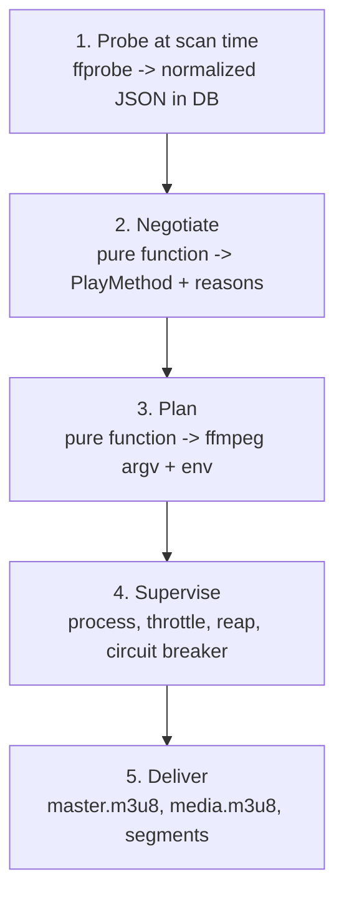
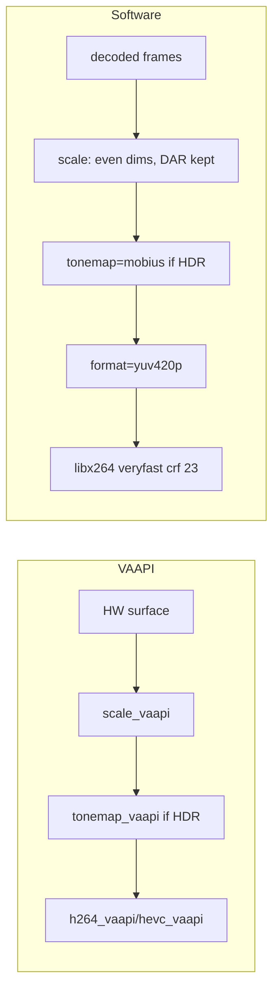
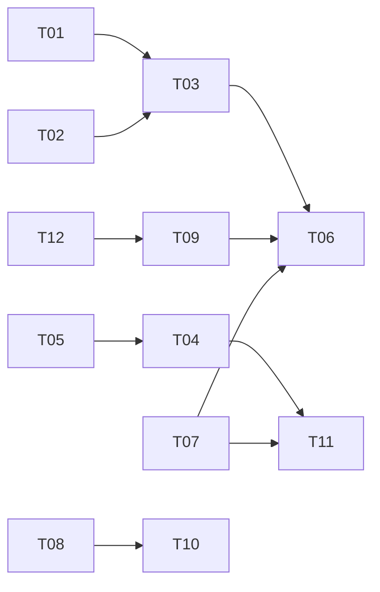

# Video Playback & Transcoding: Reference Spec and Agent Work Plan

> **Audience:** AI coding agents (and humans reviewing their work).
> **Goal:** Upgrade Hearth's HLS playback/transcoding engine to production-grade reliability, one small verifiable task at a time.
> **Source of truth:** This file. If code and this file disagree, stop and report the conflict (see §0.4) instead of guessing.

---

## 0. How to Use This Document (Read First)

### 0.1 Operating rules for agents

1. **Verify before editing.** File paths in this document come from an earlier audit and may be stale. Before each task, confirm every listed path and symbol exists (`ls`, `grep -rn`). If one is missing, locate its real equivalent and note the correction in your PR description.
2. **One task = one branch = one PR.** Task IDs are `T01`–`T12`. Do not bundle tasks. Do not start a task before its dependencies (§5 graph) are merged.
3. **Test first.** For each task, write the failing tests listed under "Acceptance" first, watch them fail, then implement.
4. **Smallest diff that satisfies acceptance criteria.** No drive-by refactors, renames, or formatting sweeps. Out-of-scope items are listed per task.
5. **Never guess ffmpeg behavior.** If a flag's behavior matters, verify it with the real `ffmpeg` binary using the smoke tests in §6 and record the ffmpeg version (`ffmpeg -version`) in the PR.
6. **Discover tooling, don't assume it.** Find the test/lint/type-check commands in `pyproject.toml`, `Makefile`, `package.json`, or CI config (`.github/workflows/`). Run all of them before opening a PR.
7. **Fail loudly, degrade gracefully.** Every new failure path must log with `session_id` and a stable error code, and must have a defined client-visible behavior (status code, header, retry hint).

### 0.2 Definition of Done (every task)

- [ ] All acceptance criteria for the task are met and each has an automated test.
- [ ] Existing test suite, linter, and type checker pass.
- [ ] No invariant in §2 is violated (cite the invariant IDs you touched in the PR).
- [ ] New config values are named constants or settings, not magic numbers.
- [ ] PR description contains: task ID, what changed, how it was verified, ffmpeg version used, and any deviation from this document.
- [ ] This document is updated if behavior or file locations changed (append to §8 Changelog).

### 0.3 Priority legend

| Tag | Meaning |
|---|---|
| **P0** | Correctness or resource-safety bug. Do first. |
| **P1** | Compatibility or robustness. Do next. |
| **P2** | Polish and efficiency. |

### 0.4 When to stop and ask

Stop and report (do not improvise) if: a task's premise is false (e.g. the bug is already fixed); the change requires a schema migration or a public API break not described here; an acceptance criterion cannot be tested without hardware the environment lacks (VAAPI/NVENC); or two documented rules conflict.

---

## 1. Mental Model

The streaming subsystem makes one guarantee:

> Given a client's device capabilities, negotiate the cheapest working playback path (Direct Play, Remux, or Transcode), stream it seamlessly, adapt to seeking and network conditions, and reclaim server compute and disk.



### 1.1 Play methods

| Method | When | Server cost |
|---|---|---|
| **DirectPlay** | Container, video, and audio all supported; bitrate within limits | None (HTTP range requests on `/api/v1/stream/{file_id}`) |
| **Remux / DirectStream** | Video OK; only container or audio unsupported | Low: `-c:v copy`, audio re-encoded, repackaged to HLS fMP4 |
| **Transcode** | Any video constraint fails, or subtitle burn-in required | High: full video re-encode |

### 1.2 Cross-cutting rules

- **Time units:** Hearth uses float seconds internally and milliseconds in some DTOs. Convert in exactly one place per boundary and name variables with units (`start_s`, `duration_ms`).
- **Session identity:** every negotiation mints a `session_id`. Progress, keepalive, segment, and stop calls must echo it.
- **Media tokens:** `<video>`/hls.js segment requests cannot send `Authorization` headers. Authenticate with short-lived HMAC-signed `?token=` scoped to (user, item, session).
- **Query binding:** bind query parameters case-insensitively (`VideoBitrate` vs `videoBitRate`); otherwise negotiated limits are silently dropped by some players.

---

## 2. Invariants

Agents MUST NOT violate these. Each has an ID for citation in PRs and tests.

| ID | Invariant |
|---|---|
| **INV-1** | Probing happens at scan time only, never on a playback request. |
| **INV-2** | Unknown probe values are stored as `null`, never fabricated defaults. |
| **INV-3** | Negotiation and command planning are **pure functions** (no I/O, no clock, no globals). Process management lives only in the supervisor. |
| **INV-4** | ffmpeg is launched with an **argv list**, never `shell=True`, never string-concatenated commands. |
| **INV-5** | Segment files become visible to clients only when complete (atomic rename). |
| **INV-6** | A paused ffmpeg process is always resumed before it is terminated. |
| **INV-7** | Segment endpoints never return 404 for a segment that exists in the playlist but failed to generate. They return 503 + `Retry-After`. |
| **INV-8** | A seek never deletes segments that are already complete on disk. Only session end/reap deletes the session directory. |
| **INV-9** | Software-encoded H.264 output is always `yuv420p` (never High 10). |
| **INV-10** | Any client-supplied path component (segment name, session id) is validated against a strict regex before touching the filesystem. |
| **INV-11** | `-force_key_frames` / `-sc_threshold` are applied only when re-encoding video, never with `-c:v copy`. |
| **INV-12** | Every ffmpeg start, exit (with code), pause, resume, and kill is logged with `session_id`. |

---

## 3. Reference Specification

### 3.1 Probing and normalization

Command:

```
ffprobe -i <path> -threads 0 -v warning -print_format json -show_streams -show_format -show_chapters
```

Persist normalized fields (all nullable):

- **Video:** codec, profile, level, width, height, SAR/DAR, `r_frame_rate` and `avg_frame_rate`, bit depth (derive from `pix_fmt`: `yuv420p` = 8, `yuv420p10le` = 10), color space/primaries/transfer (`smpte2084` = PQ, `arib-std-b67` = HLG), Dolby Vision config, HDR10+ presence, field order.
- **Audio:** codec, profile, channels, channel layout, sample rate, bit rate, language, dispositions.
- **Subtitles:** codec (`subrip`, `ass`, `webvtt`, `hdmv_pgs_subtitle`, `dvd_subtitle`), language, title, dispositions.
- **Attachments:** embedded fonts (`.ttf`, `.otf`) for ASS rendering.

**Unknown bitrate:** assume **40 Mbps** in bandwidth checks (INV-2 applies to storage; this default applies only at decision time). A low default such as 5 Mbps wrongly approves Direct Play for heavy files on slow links.

### 3.2 Client profile

```json
{
  "containers": ["mp4", "webm"],
  "video_codecs": [
    {"codec": "h264", "profiles": ["baseline", "main", "high"], "max_level": 51},
    {"codec": "hevc", "profiles": ["main", "main 10"], "max_level": 150}
  ],
  "audio_codecs": [{"codec": "aac", "max_channels": 6}],
  "subtitle_profiles": [{"format": "vtt", "method": "External"}, {"format": "pgs", "method": "Encode"}],
  "max_width": 3840, "max_height": 2160,
  "max_bitrate": 50000000,
  "hdr": false,
  "hls_fmp4": true
}
```

Browser `isTypeSupported` only proves *decode support*, not hardware acceleration or battery cost. Treat the profile as a capability ceiling, not a performance guarantee.

### 3.3 Transcode reasons (compute the full union, don't stop at first failure)

| Reason | Remux-eligible |
|---|---|
| `ContainerNotSupported` | Yes |
| `AudioCodecNotSupported` | Yes |
| `AudioChannelsNotSupported` | Yes |
| `AudioSampleRateNotSupported` | Yes |
| `VideoCodecNotSupported` | No |
| `VideoProfileNotSupported` | No |
| `VideoLevelNotSupported` | No |
| `VideoResolutionNotSupported` | No |
| `ContainerBitrateExceedsLimit` | No |
| `VideoRangeTypeNotSupported` | No (tonemap transcode) |
| `SubtitleBurnInRequired` | No |

**Remux rule:** remux is allowed iff the reason set is a subset of {`ContainerNotSupported`, `AudioCodecNotSupported`, `AudioChannelsNotSupported`, `AudioSampleRateNotSupported`}. An empty set means DirectPlay.

### 3.4 Bitrate budgeting

| Total cap | Audio bitrate |
|---|---|
| <= 640 kbps | 128 kbps |
| <= 2 Mbps | 192 kbps |
| <= 10 Mbps | 384 kbps |
| > 10 Mbps | 640 kbps |

`video_bitrate = max(total_cap - audio_bitrate, 64 kbps)`

Stereo downmix of 5.1/7.1: use an explicit `pan`/`aresample` matrix, not ffmpeg's default. Night-mode variant: center +3 dB, L/R -3 dB, surrounds -6 dB; always apply a limiter to avoid clipping.

### 3.5 ffmpeg command planner

Argument order matters:

```
ffmpeg -hide_banner -loglevel warning -y \
  [-hwaccel vaapi -hwaccel_output_format vaapi -vaapi_device /dev/dri/renderD128] \
  [-ss <start_s>] [-noaccurate_seek  # only when video is copied] \
  -analyzeduration 100M -probesize 1G \
  -i <input> \
  ...codec/filter args... \
  -f hls -hls_time <seg_s> -hls_playlist_type vod -hls_segment_type fmp4 \
  -hls_flags temp_file -start_number <n> ...
```

- **Input-side `-ss`** (before `-i`) for instant container seek.
- **Timestamp continuity after a mid-file start:** when starting at offset `S`, segments must carry timestamps continuing the global timeline. Verify with the smoke test in §6.3 whether `-output_ts_offset <S>` is required for the pinned ffmpeg version; the playlist and `#EXTINF` accounting must stay consistent with the first segment index.
- **Keyframes (re-encode only, INV-11):** `-force_key_frames "expr:gte(t,n_forced*<seg_s>)"`. For `libx264` also `-sc_threshold 0`. For hardware encoders, set GOP explicitly (`-g <fps*seg_s> -keyint_min <fps*seg_s>`) since `-sc_threshold` does not apply.
- **Subtitle burn-in paths:** ffmpeg's `subtitles=` filter breaks on quotes, brackets, and colons. Symlink the source to a clean name inside the session dir (e.g. `sub_source.mkv`) and reference that.
- **HEVC in fMP4 HLS:** add `-tag:v hvc1` so Apple clients accept it.

Filter chains:



**Hardware fallback:** if a hardware decode/encode run exits non-zero, log the stderr tail and restart once with the software chain. Count this restart toward the circuit breaker (T07) so it cannot loop.

### 3.5.1 Supervisor behavior

| Concern | Rule |
|---|---|
| Throttle | Pause when `lead >= 60 s`, resume when `lead <= 20 s`, checked every 5 s. `lead = encoded_time - last_requested_segment_end`. |
| Pause mechanism | Prefer `SIGSTOP`/`SIGCONT` on POSIX (deterministic, stateless). Stdin `p` in stock ffmpeg is a **toggle**, so if used it requires tracked state and a stdin pipe without `-nostdin`. Choose one and document the choice. |
| Seek outside lookahead | `SIGTERM` current process, keep files, compute `start_number = floor(seek_s / seg_s)`, spawn new ffmpeg. If target segment already exists on disk, serve it without restarting. |
| Consumer guard | `active_request_count` incremented/decremented around each segment response (including streaming body). Reaper must skip sessions with count > 0. |
| Idle reaper | No activity for 60 s (HLS) or 10 s (progressive) and count == 0: resume if paused, terminate, delete session dir. |
| Circuit breaker | 3 consecutive crashes within 30 s: open for 10 s, respond 503 + `Retry-After: 10`. Close after cooldown; first success resets the counter. |

### 3.6 HLS delivery

**Master playlist** (`master.m3u8`): `BANDWIDTH`, `AVERAGE-BANDWIDTH`, `RESOLUTION`, `FRAME-RATE`, and an accurate `CODECS` list (RFC 6381), plus a `SUBTITLES` group when applicable.

RFC 6381 strings:

| Codec | Format | Example |
|---|---|---|
| H.264 | `avc1.<profile_idc hex><constraint hex><level_idc hex>` | `avc1.640028` (High, L4.0) |
| HEVC | `hvc1.<profile>.<compat flags>.<L\|H><level_idc>.<constraints>` | `hvc1.1.6.L150.B0` (Main, L5.0; level_idc = level x 30) |
| AV1 | `av01.<profile>.<level idx><tier>.<bit depth>` | `av01.0.08M.08` |
| AAC-LC / HE-AAC | `mp4a.40.2` / `mp4a.40.5` | |
| AC-3 / E-AC-3 / Opus | `ac-3` / `ec-3` / `Opus` | |

**Variant playlist** (`media.m3u8`): VOD, full timeline up front, `#EXT-X-MAP` for `init.mp4`, last segment shorter than the rest, `#EXT-X-ENDLIST`. Segment URIs carry the media token.

---

## 4. Current State vs Target (Gap Analysis)

| Area | Current Hearth (per prior audit; verify) | Target | Task | Pri |
|---|---|---|---|---|
| Client profile | Omitted; defaults to `unknown` (1080p, 4 Mbps) | MSE-detected profile + UA fallback | T04 | P0 |
| Throttling | None | 60 s / 20 s pause/resume | T06 | P0 |
| Seek cache | Unlinks all files on seek | Keep segments (INV-8) | T03 | P0 |
| Segment atomicity | Direct writes to `.m4s` | `-hls_flags temp_file` | T01 | P0 |
| Keyframes | Source-dependent | Forced at segment boundaries | T02 | P1 |
| Manifest CODECS | Hardcoded `avc1.640028,mp4a.40.2` | Computed from real streams | T08 | P1 |
| Failure mode | 404 -> hls.js skip-walks the playlist | 503 + Retry-After, circuit breaker | T07 | P1 |
| Consumer tracking | Timestamp `touch()` | Ref-counted guard | T09 | P2 |
| Subtitles | Burns in all ASS/SSA/bitmap | Text subs as WebVTT tracks; burn-in only if needed | T10 | P2 |
| Decision engine | Unaudited | Reason-union + remux rule + unknown-bitrate default | T05 | P1 |
| Frontend resilience | Unaudited | Retry-After handling, sendBeacon stop | T11 | P2 |
| Path/token safety | Unaudited | INV-10 enforced | T12 | P1 |

---

## 5. Task Backlog

### Dependency graph



Tasks without incoming edges may start immediately: **T01, T02, T05, T07, T08, T12**.

Each task lists **Files** (verify first), **Change**, **Acceptance** (each item needs a test), and **Out of scope**.

---

### T01 (P0): Atomic segment writes

- **Files:** `app/services/transcode/builder.py` (`build_ffmpeg_hls_command`)
- **Change:** add `-hls_flags temp_file` (merge with existing `-hls_flags` using `+`, e.g. `temp_file+independent_segments`, never emit the flag twice).
- **Acceptance:**
  1. Unit test: generated argv contains exactly one `-hls_flags` whose value includes `temp_file`.
  2. Integration/smoke (§6.3): while ffmpeg runs, no file ending `.m4s`/`.ts` is ever shorter than its final size; temp files use a `.tmp` suffix.
  3. Segment endpoint ignores `.tmp` files and treats only final names as available (ties to INV-5, INV-10).
- **Out of scope:** keyframe flags (T02).

### T02 (P1): Forced keyframes at segment boundaries

- **Files:** `builder.py`
- **Change:** when the video stream is re-encoded, add `-force_key_frames expr:gte(t,n_forced*{seg_s})`; add `-sc_threshold 0` only for `libx264`; for hardware encoders set `-g`/`-keyint_min` from fps x `seg_s`. When `-c:v copy`, add none of these (INV-11).
- **Acceptance:**
  1. Unit tests for three planner modes: libx264, VAAPI, copy. Copy mode must contain neither flag.
  2. Smoke test: `ffprobe -show_packets` on produced segments shows each segment begins with a keyframe and durations are within 50 ms of `seg_s` (last segment excepted).
- **Out of scope:** copy-mode keyframe snapping (segments follow source GOP; document the resulting variable `#EXTINF`).

### T03 (P0): Non-destructive seeking

- **Depends on:** T01, T02
- **Files:** `app/services/transcode/session.py` (`TranscodeSession.seek`), HLS segment handler in `app/api/v1/hls.py`
- **Change:**
  1. `seek(target_s)`: if the target segment file already exists, do nothing. Otherwise terminate the active ffmpeg (respecting INV-6) **without touching the output dir**, then spawn a new ffmpeg with `-ss <target_s>` and `-start_number <floor(target_s/seg_s)>`.
  2. Make the segment handler wait (bounded, e.g. 10 s) for a segment that the current/new process is about to produce; on timeout return 503 + `Retry-After` (INV-7).
  3. Resolve the timestamp continuity question from §3.5 and encode the answer in the planner with a comment citing the smoke test.
- **Acceptance:**
  1. Test: seek forward then back into a previously produced range -> no new ffmpeg process is spawned and files are unchanged (inode/mtime assertions).
  2. Test: seek forward -> old process terminated, new argv has correct `-ss` and `-start_number`.
  3. Smoke: segments produced after a seek play back-to-back with earlier ones in `ffplay`/hls.js without a timestamp jump.
  4. No code path other than session end/reap deletes segments (grep proof in PR).
- **Out of scope:** disk-quota eviction.

### T04 (P0): Client capability detection and profile resolution

- **Depends on:** T05
- **Files:** `web/src/lib/components/VideoPlayer.svelte`, `app/services/transcode/profile.py`, the `POST /items/{item_id}/playback-info` schema/handler
- **Change:**
  1. Frontend: implement `detectBrowserCapabilities()` using `MediaSource.isTypeSupported` / `canPlayType` (guard for missing `MediaSource`, e.g. iOS Safari uses native HLS). Send as `capabilities` in the playback-info body. Cache the result per page load.
  2. Backend: schema-validate `capabilities` (unknown fields ignored, bad types -> 422). If absent, fall back to a User-Agent preset (Chrome, Safari, Firefox, Android TV). Only if UA is unrecognized use a conservative `unknown` preset.
  3. Bind query params case-insensitively where the legacy query path exists.
- **Acceptance:**
  1. Backend tests: explicit capabilities win over UA preset; UA preset wins over `unknown`; malformed capabilities -> 422 with field path.
  2. Frontend unit test with mocked `MediaSource` verifies the emitted profile for (H.264 only), (H.264+HEVC), and (no MediaSource).
  3. Existing clients that send no capabilities still play (regression test).
- **Out of scope:** per-device persistent profiles.

### T05 (P1): Decision-engine audit and correctness

- **Files:** negotiation module under `app/services/transcode/` (locate it)
- **Change:** audit against §3.3-§3.4 and fix deviations: compute the **full reason union**; apply the Remux rule exactly; use 40 Mbps for unknown bitrate; enforce INV-2 (no fabricated defaults); keep the function pure (INV-3). Add the `-pix_fmt`/`format=yuv420p` guard (INV-9) in the planner's software chain; implement the hardware -> software fallback hook (restart once, counted by T07).
- **Acceptance (table-driven tests):**
  1. (MKV, H.264, AC3) on an MP4/H.264/AAC-only client -> reasons = {Container, AudioCodec}, method = Remux.
  2. (MP4, HEVC) on an H.264-only client -> Transcode, reasons contain `VideoCodecNotSupported`.
  3. Source with null bitrate and 8 Mbps cap -> Transcode (40 Mbps assumed).
  4. 10-bit H.264 source via software path -> argv contains `format=yuv420p`.
  5. Function purity: same inputs -> identical output; no filesystem/clock access (enforce by running with those patched to raise).

### T06 (P0): Transcode throttling

- **Depends on:** T03, T07, T09
- **Files:** `session.py`, supervisor/manager module, `hls.py` (record last served segment)
- **Change:** implement `pause()` / `resume()` idempotently with tracked state, using the mechanism chosen in §3.5.1. Supervisor tick every 5 s computes `lead` from encoded time (parse ffmpeg `-progress` output or count completed segments) minus `last_served_segment_end`; pause at >= 60 s, resume at <= 20 s. `stop()` calls `resume()` first (INV-6). Log every transition (INV-12).
- **Acceptance:**
  1. Unit test with a fake clock/process: lead 61 -> pause called once; lead 19 -> resume called once; repeated ticks at the same state produce no extra calls.
  2. `stop()` on a paused session issues resume before terminate (assert call order).
  3. Smoke: a 2-hour source with no client requests stops advancing at ~60 s lead (CPU near idle) and continues when segments are requested.
  4. A paused session is still reaped after the idle timeout without leaking a stopped process (`ps` check in integration test).
- **Out of scope:** adaptive thresholds per bitrate.

### T07 (P1): Circuit breaker and 503 semantics

- **Files:** `SessionManager`, `hls.py`
- **Change:** track consecutive startup/exit failures per session; after 3 within 30 s open the breaker for 10 s. While open, segment requests return **503** with `Retry-After: 10` and a JSON error code. Replace any 404-on-generation-failure path (INV-7). Genuine nonexistent session or invalid segment name stays 404/400.
- **Acceptance:**
  1. Integration test: fake ffmpeg that exits 1 -> after 3 failures, response is 503 with `Retry-After`; after cooldown a new attempt is allowed; a success resets the counter.
  2. Test: no request during the open state spawns a new process.
  3. Hardware-fallback restart counts as one failure.

### T08 (P1): Dynamic RFC 6381 codec strings

- **Files:** new `app/services/transcode/codecs.py`, `app/api/v1/hls.py`
- **Change:** implement `video_codec_string(codec, profile, level, bit_depth, ...)` and `audio_codec_string(codec, profile)` per §3.6. Derive from the **output** stream (transcode target if re-encoded, else source). Master playlist uses these plus real `BANDWIDTH`/`RESOLUTION`/`FRAME-RATE`. Unknown inputs -> omit that codec from `CODECS` rather than inventing one (INV-2).
- **Acceptance:** `tests/unit/test_transcode_codecs.py` covers: H.264 Baseline/Main/High at 3.0/3.1/4.0/5.1; HEVC Main L93/L150; AV1 8-bit; AAC-LC, HE-AAC; AC-3, E-AC-3; unknown profile -> omitted. Golden-string assertions. Master playlist test asserts no hardcoded `avc1.640028` remains for non-High/4.0 sources.

### T09 (P2): Active request accounting and idle reaper

- **Depends on:** T12
- **Files:** `session.py`, `hls.py`
- **Change:** add `active_request_count` and an async context manager `session.track_request()` wrapping segment handling **including body streaming** (use `try/finally` / response background task so disconnects decrement). Reaper skips sessions with count > 0; timeouts per §3.5.1.
- **Acceptance:** tests for increment/decrement on success, exception, and client disconnect; reaper does not kill a session mid-slow-download (simulate with a throttled body); count never goes negative.

### T10 (P2): Subtitle pipeline

- **Depends on:** T08
- **Files:** subtitle extraction code, `hls.py`, planner
- **Change:** text subtitles (SRT/ASS/WebVTT) are converted to WebVTT and exposed as an HLS `SUBTITLES` group (`subtitles.m3u8`); no video transcode is triggered for them. Bitmap subs (PGS/DVD) and any client lacking a text method use burn-in (`SubtitleBurnInRequired`) via the symlink technique (§3.5). ASS styling is lossy in WebVTT: if the profile lists `ass` as `External`, deliver ASS to a capable renderer instead.
- **Acceptance:** SRT on a client with VTT support -> method stays Remux/DirectStream when otherwise eligible; PGS -> Transcode with burn-in and filter path points at the symlink; filenames containing quotes, brackets, and colons work (parametrized test).

### T11 (P2): Frontend resilience

- **Depends on:** T04, T07
- **Files:** `VideoPlayer.svelte`
- **Change:** configure hls.js retry/backoff to honor `Retry-After` on 503; send progress every 10 s and immediately on pause; send `navigator.sendBeacon('/api/v1/hls/{sessionId}/stop')` on `pagehide`/component destroy (use `pagehide`, not `beforeunload`, for mobile reliability). The stop endpoint must accept beacon semantics (POST, token in query or body since headers are not settable).
- **Acceptance:** component tests with mocked hls.js and `navigator.sendBeacon`; Playwright test (§6.4) shows playback recovering after a forced 503 burst without request storms (cap on requests/sec asserted).

### T12 (P1): Path and token hardening

- **Files:** `hls.py`, token utilities
- **Change:** enforce INV-10: segment names must match `^(init\.mp4|seg_\d{1,6}\.(m4s|ts))$`; `session_id` must match a strict UUID/hex pattern; resolve the final path and assert it stays inside the session dir. Tokens: HMAC-signed, include user, item, session, expiry; constant-time comparison; reject expired.
- **Acceptance:** tests for `../`, absolute paths, encoded traversal (`%2e%2e`), overlong names, wrong-session token, expired token -> all 400/401/403 and never touch the filesystem outside the session dir.

---

## 6. Verification

### 6.1 Test layout

- `tests/unit/test_transcode_builder.py` (T01, T02, T05)
- `tests/unit/test_transcode_codecs.py` (T08)
- `tests/unit/test_transcode_throttler.py` (T06)
- `tests/unit/test_transcode_decision.py` (T05)
- `tests/integration/test_hls_seeking.py` (T03)
- `tests/integration/test_circuit_breaker.py` (T07)
- `tests/integration/test_hls_security.py` (T12)

Use a **fake ffmpeg executable** (a small script honoring the same CLI shape) for deterministic crash/throttle tests; use the real binary only for tests marked `@pytest.mark.ffmpeg` (skippable when ffmpeg is absent).

### 6.2 Test media

Generate fixtures rather than committing large files:

```bash
# 60 s, H.264 High, AAC, keyframe every 2 s
ffmpeg -f lavfi -i testsrc2=size=1280x720:rate=24 -f lavfi -i sine=frequency=440 -t 60 \
  -c:v libx264 -g 48 -pix_fmt yuv420p -c:a aac fixture_h264.mp4

# 10-bit HEVC (exercises the yuv420p guard / transcode path)
ffmpeg -f lavfi -i testsrc2=size=1280x720:rate=24 -t 30 \
  -c:v libx265 -pix_fmt yuv420p10le fixture_hevc10.mkv
```

### 6.3 Smoke checks (real ffmpeg)

```bash
# Segment boundaries start on keyframes and have expected durations
ffprobe -v error -select_streams v:0 -show_entries packet=pts_time,flags \
  -of csv=p=0 seg_000.m4s | head

# Atomicity: poll during a run; no partial final-named files
while pgrep ffmpeg >/dev/null; do ls -l session_dir | grep -E '\.(m4s|ts)$'; sleep 0.2; done

# Timestamp continuity after seek: first PTS of the first post-seek segment
# should be ~ start_number * seg_s (± one frame)
ffprobe -v error -show_entries packet=pts_time -of csv=p=0 -read_intervals %+#1 seg_015.m4s
```

Record outputs and the `ffmpeg -version` line in the PR.

### 6.4 End-to-end (Playwright)

Chromium and Firefox desktop plus a mobile emulation profile: start playback of H.264 and HEVC-10-bit fixtures, seek forward/back/forward, throttle the network, force a 503 burst on segments, and assert: playback resumes, no more than N requests/second hit the segment endpoint, and `/stop` is received on navigation away.

### 6.5 Regression checklist before merging the final task

- [ ] No place in the codebase deletes session segment files other than session end/reap.
- [ ] `grep -rn "avc1.640028"` returns only tests/golden data.
- [ ] Every `subprocess` call uses an argv list.
- [ ] No segment path returns 404 for a playlist-listed segment during generation.
- [ ] CPU is idle when no client is requesting segments and lead >= 60 s.

---

## 7. Assumptions to Verify (Agents: confirm or correct in PR)

1. Paths named in §5 exist as written.
2. The pinned ffmpeg version supports the flags used (`-hls_flags temp_file` with fMP4, `-noaccurate_seek`). *Verified: ffmpeg 7.1.5-0+deb13u1 supports `-hls_flags temp_file` with fMP4 segments and playlists.*
3. Whether `-output_ts_offset` is needed for mid-file starts with fMP4. *Verified: FFmpeg 7.1.5 resets output packet timestamps to 0 without `-output_ts_offset`; setting `-output_ts_offset <start_offset>` anchors post-seek first PTS at `start_number * seg_s`, ensuring continuous timeline.*
4. Pause mechanism choice (SIGSTOP/SIGCONT vs stdin toggle) and whether the deployment target includes Windows (SIGSTOP unavailable there).
5. Test, lint, and type-check commands (discover from repo config).
6. Whether VAAPI/NVENC tests can run in CI; if not, rely on argv-only unit tests for those branches.

---

## 8. Changelog

| Date | Task | Summary | PR |
|---|---|---|---|
| 2026-11-12 | T01 | Atomic segment writes: added `-hls_flags temp_file` with flag merging, unit tests, ffmpeg smoke test, and endpoint rejection of `.tmp` | T01 |
| 2026-11-12 | T02 | Forced keyframes at segment boundaries: added `-force_key_frames` + `-sc_threshold 0` (libx264) and `-g`/`-keyint_min` (VAAPI); verified first-packet keyframes & <50ms duration delta; copy mode unchanged (variable #EXTINF) | T02 |
| 2026-11-12 | T03 | Non-destructive seeking: cached segment reuse without process respawn, file deletion removed from seek (INV-8), resume before stop (INV-6), bounded wait with 503 Retry-After on segment timeout (INV-7), and -output_ts_offset for seamless timeline continuity | T03 |

*(Agents: append a row per merged task.)*
